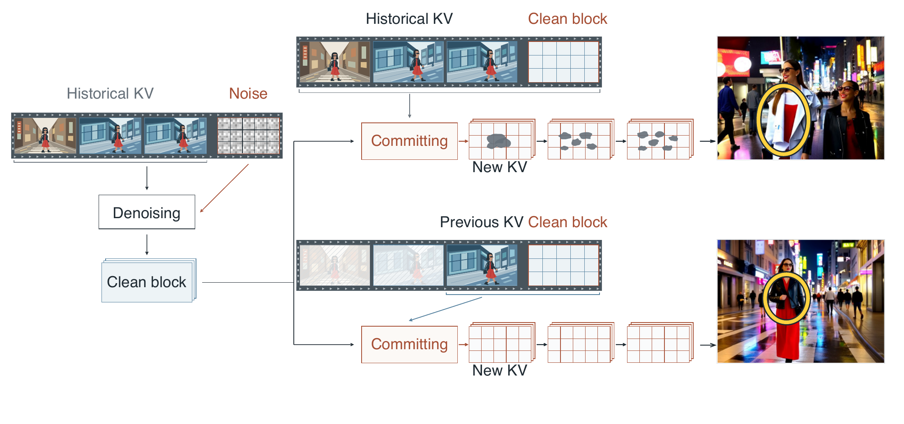
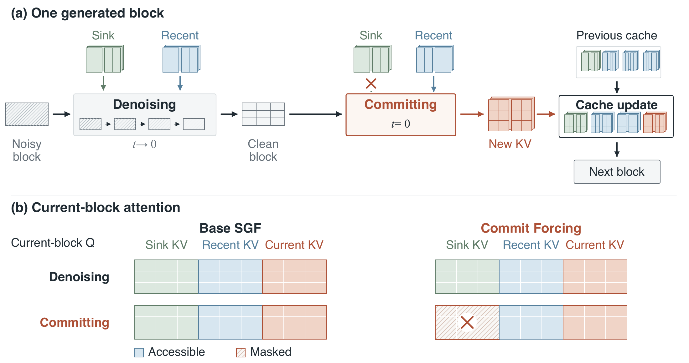
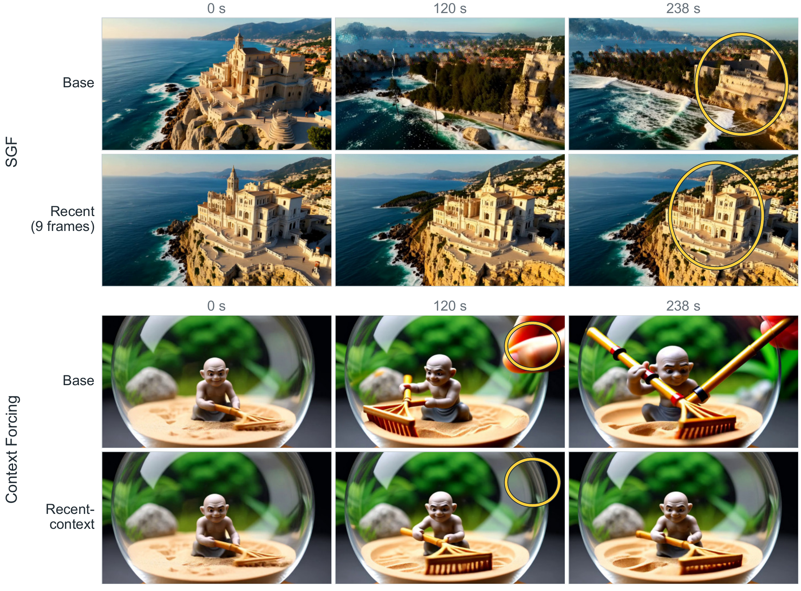
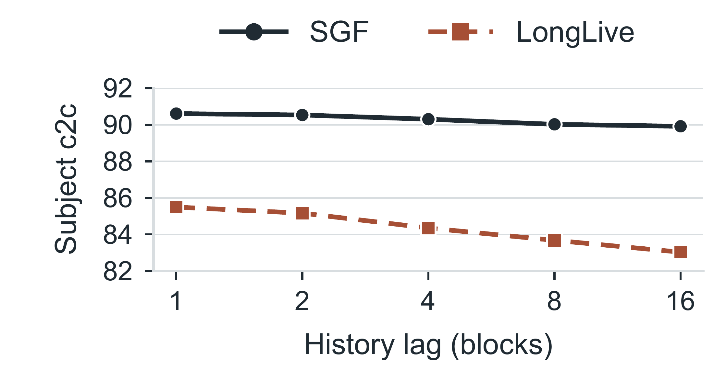
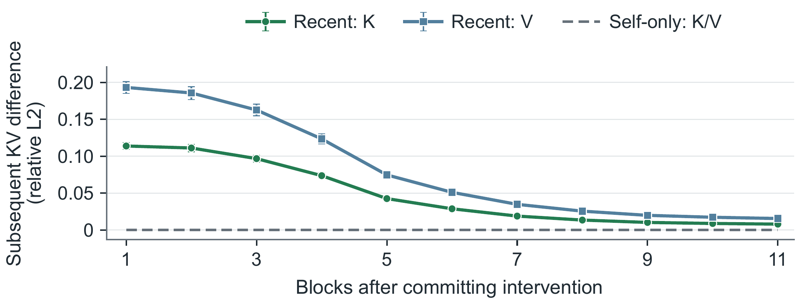

<div align="center">

<h1>What Helps Denoising Can Hurt Memory:<br>Rethinking History in Long Video Generation</h1>

**Commit Forcing: a training-free rule for what a long-video model writes into its KV cache.**

[](#news)&nbsp;
[](#supported-models)&nbsp;
[](RESULTS.md)&nbsp;
[](LICENSE)

</div>

## News

<table>
<tr><td></td><td><b>Initial release</b>: Code and evaluation results are available.</td></tr>
<tr><td></td><td><b>arXiv preprint</b></td></tr>
</table>

<p align="center">
  
</p>

<sub>Historical context has different effects when a block is denoised and when it is committed to the KV cache.</sub>

---

Autoregressive video diffusion uses historical KV to denoise the current block and to construct clean KV for
future blocks. On LongLive and SGF, sink access helps denoising but can increase drift during committing.
At fixed context size and temporal positions, older trajectory content produces lower mean long-range Subject
Consistency on both generators.

**Commit Forcing** preserves the base denoising policy and constructs clean KV from the current block and a
configurable window of recent frames from the original generated trajectory. It requires no training or additional
DiT forwards. On SGF, the sink stays stored and available during denoising; only its direct use during committing is masked.

## Contributions

- **Stage and source effects.** Controlled interventions on LongLive and SGF show that historical context can have
  different effects during denoising and committing, even at fixed read counts.
  ([stage interventions](analysis/longlive_sink/README.md), [historical sources](analysis/committing_source/README.md))
- **Recency and propagation.** We vary historical age at fixed context size and positions, and isolate how a single
  committing intervention propagates through recent KV with clean latents fixed. Recent versus self-only committing
  exposes generator-dependent continuity and motion tradeoffs.
  ([historical recency](analysis/committing_content_age/README.md), [KV propagation](analysis/committing_propagation/README.md))
- **Training-free committing.** Across 7 methods and 8 configurations, Commit Forcing improves Quality and Total
  significantly in 5 configurations on 60-second VBench. Long-range Subject gains reproduce with 2 generation seeds
  and extend to 240-second videos. ([results](#results))

<p align="center">
  
</p>

<sub>The clean committing pass reads the current block and a configurable recent window. Base denoising and cache
storage remain in place; the window controls the dependencies carried into newly constructed KV.</sub>

## Results

**Main evaluation: full VBench, 60 s**, the common 946-entry suite, one video per entry (generation seed 0), all 16 dimensions.
Each row compares the same released weights with and without Commit Forcing. Native denoising and sampler settings
remain model-specific; the generation prompts and scoring protocol are shared. The committing adaptations are
described in [Supported models](#supported-models).

<table>
<thead>
<tr><th rowspan="2" align="left">Model</th><th colspan="3">Quality</th><th colspan="3">Total</th></tr>
<tr><th>Base</th><th>+ CF</th><th>Δ</th><th>Base</th><th>+ CF</th><th>Δ</th></tr>
</thead>
<tbody>
<tr><td>Context Forcing</td><td align="right">84.79</td><td align="right">85.25</td><td align="right"><b>+0.46</b></td><td align="right">82.24</td><td align="right">82.68</td><td align="right"><b>+0.44</b></td></tr>
<tr><td>ID-Forcing on LongLive</td><td align="right">84.91</td><td align="right">84.64</td><td align="right">−0.27</td><td align="right">82.92</td><td align="right">82.91</td><td align="right">−0.01</td></tr>
<tr><td>Recency Forcing, training-free †</td><td align="right">84.77</td><td align="right">85.24</td><td align="right"><b>+0.47</b></td><td align="right">82.24</td><td align="right">83.08</td><td align="right"><b>+0.85</b></td></tr>
<tr><td>ID-Forcing on Self-Forcing</td><td align="right">85.26</td><td align="right">85.21</td><td align="right">−0.05</td><td align="right">82.96</td><td align="right">83.15</td><td align="right">+0.19</td></tr>
<tr><td>Rolling Sink</td><td align="right">84.84</td><td align="right">85.15</td><td align="right"><b>+0.32</b></td><td align="right">82.90</td><td align="right">83.18</td><td align="right"><b>+0.28</b></td></tr>
<tr><td>LongLive</td><td align="right">84.70</td><td align="right">84.99</td><td align="right"><b>+0.29</b></td><td align="right">83.05</td><td align="right">83.36</td><td align="right"><b>+0.31</b></td></tr>
<tr><td>SGF+</td><td align="right">86.32</td><td align="right">86.61</td><td align="right">+0.29</td><td align="right">84.30</td><td align="right">84.60</td><td align="right">+0.30</td></tr>
<tr><td>SGF</td><td align="right">86.06</td><td align="right">87.22</td><td align="right"><b>+1.16</b></td><td align="right">83.85</td><td align="right">84.94</td><td align="right"><b>+1.09</b></td></tr>
</tbody>
</table>

Rows follow the paper's ascending Total with Commit Forcing. Scores ×100. **+ CF**: + Commit Forcing; **Δ**: + CF − Base. Bold Δ marks statistically significant changes.
Quality combines seven visual dimensions; Total also includes nine semantic dimensions.
† RF-TF applies Recency Forcing's Temporal Response Bias to released Self-Forcing weights; it uses no RF-trained checkpoint.
Quality and Total improve significantly in 5 configurations. SGF has the largest Total gain, +1.09 points.
[All dimensions, intervals and protocol records](results/vbench_full/common946/README.md).
SGF's Quality gain is concentrated in motion retention: Dynamic Degree contributes 1.10 of its 1.16 points.
[Quality decomposition and measured cost](analysis/quality_cost/README.md).

**MovieGen cross-protocol check, 60 s videos**, 200 fixed [MovieGen prompts](eval/prompts/README.md), generation seed 0.
Quality combines VBench's seven visual dimensions using its official normalization and weights.

| Model | Base | + Commit Forcing | Δ Quality | Δ Consistency |
|:---|--:|--:|--:|--:|
| SGF | 83.58 | 84.62 | **+1.04** | **+4.40** |
| Recency Forcing, training-free † | 82.01 | 82.47 | **+0.46** | **+3.86** |
| LongLive | 82.23 | 82.73 | **+0.49** | **+1.20** |
| Context Forcing, sink exclusion | 82.78 | 83.11 | **+0.32** | **+1.80** |
| Context Forcing, full rule | 82.78 | 82.91 | +0.13 | **+3.23** |
| Rolling Sink | 82.61 | 82.72 | +0.11 | **+0.67** |
| Self-Forcing with sink | 81.33 | 81.63 | +0.31 | **+3.38** |

Base: the original model. + Commit Forcing: the same weights and initial noise, with Commit Forcing (no training).
Consistency: VBench-Long's clip-to-clip subject consistency, our measure of long-range consistency.
**bold Δ**: the paired 95% bootstrap interval excludes 0. All seven clip-to-clip Subject gains reproduce with generation
seed 1. [Both seeds and all metrics](RESULTS.md#committing-replication). SGF+, ID-Forcing and SGF + RF compatibility
comparisons remain in [RESULTS.md](RESULTS.md).

The standard suite scores dimension-specific subsets and applies VBench's static filter for Flickering.
The MovieGen evaluation scores all seven visual dimensions on each prompt and leaves Flickering unfiltered.
Each Base / + Commit Forcing pair shares its inputs and scoring settings.
LongLive uses 6-frame committing: 3 recent frames and the current 3-frame block.

**Longer videos, 120–240 s**, VBench-Long Quality. Compare within each prompt set:

| Model | Length | Prompts | Base | + Commit Forcing | Δ Quality | Δ Consistency |
|:---|:---|:---|--:|--:|--:|--:|
| SGF | 240 s | 32 MovieGen | 83.97 | 84.69 | **+0.72** | **+5.07** |
| Context Forcing | 240 s | 32 MovieGen | 83.60 | 84.04 | +0.44 | **+2.23** |
| LongLive, 6 frames | 120 s | 128 of ID-Forcing | 81.72 | 82.05 | **+0.33** | **+1.87** |
| LongLive, 6 frames | 240 s | 128 of ID-Forcing | 81.56 | 81.84 | **+0.28** | **+2.55** |
| ID-Forcing on Self-Forcing | 240 s | 128 of ID-Forcing | 81.32 | 81.65 | **+0.34** | **+3.58** |

Intervals, the second seed, 120 s videos and every component score: **[RESULTS.md](RESULTS.md)**.
The 240-second LongLive six-frame results are complete; the [12-frame control](results/long_horizon/README.md) remains available.

## Human evaluation

Blinded 60-second comparisons, with 18 prompt-matched pairs per comparison. Five people contributed 3 response
units, including one joint response from 3 people. Win rates exclude ties.

| Comparison | Subject and scene consistency | Overall preference |
|:---|--:|--:|
| SGF + Commit Forcing vs. SGF | **75%** | **74%** |
| LongLive + Commit Forcing vs. LongLive | 43% | 45% |
| LongLive + Commit Forcing vs. ID-Forcing | **90%** | **88%** |

[Counts, recorded intervals and evaluation protocol](results/human_evaluation/README.md).

## Qualitative comparisons

<p align="center">
  
</p>

Paired 240-second examples from the paper, using the same prompt and initial-noise seed. SGF retains church and
coastline details; Context Forcing retains the requested figure inside a glass sphere. The CF example has a lower
Quality score (−0.40 points). [Selection and source frames](assets/README.md) · [More examples and videos](assets/qualitative/README.md).

## Quickstart

### 1. Fetch the code

```bash
git clone https://github.com/Dwell-Jing/commit-forcing.git && cd commit-forcing
bash setup/fetch.sh sgf     # upstream code at the tested commit, with our patch, in third_party/sgf
```

Install the [tested environment](setup/README.md) and download the weights as described in each
[integration README](#supported-models).

### 2. Generate

```bash
python integrations/sgf/generate.py --code third_party/sgf --reading native --rule on \
    --prompts eval/prompts/rollf200.txt --ids 0-199 --seconds 60 --seed 0 --out outputs/sgf
```

- Run it again with `--rule off` for the base model; videos go to `outputs/sgf/native/rule_<on|off>/seed0/`.
- Each video has a JSON sidecar with the activation counters, the motion of the frames and `frames_md5`, the md5 of
  the frames before mp4 encoding.
- The noise of prompt `i` under seed `s` comes from `torch.manual_seed(s * 100003 + i)`.

### 3. Evaluate

```bash
python eval/vbench_long/prep.py --vbench VBench --videos outputs/sgf/native/rule_off --label sgf --work vb_work
python eval/vbench_long/prep.py --vbench VBench --videos outputs/sgf/native/rule_on --label sgf+rule --work vb_work
bash eval/vbench_long/score.sh VBench vb_work 0     # start one copy per GPU
python eval/vbench_long/collect.py --work vb_work --label sgf --out scores.csv
python eval/vbench_long/collect.py --work vb_work --label sgf+rule --out scores.csv --append
python eval/vbench_long/compare.py --scores scores.csv --seed 0 --pair sgf+rule:sgf
```

The [VBench-Long pipeline](eval/vbench_long/README.md) gives the setup (VBench @45e79ec) and the statistics; the
[full-VBench pipeline](eval/vbench_full/README.md) scores the 946-prompt suite.

### 4. Reproduce our tables

```bash
python eval/vbench_full/reproduce_common946.py
python assets/source/make_commit_effects.py --check-only
```

These commands verify the main VBench scores and the two-seed committing figure. Inputs and reproduction commands
for the other comparisons are listed in [RESULTS.md](RESULTS.md) and [results/](results/README.md).

## Supported models

| Model | Upstream code | Commit pass reads: Base | + Commit Forcing |
|:---|:---|:---|:---|
| [SGF](integrations/sgf/README.md) | [Self_Gradient_Forcing](https://github.com/zhuang2002/Self_Gradient_Forcing) | sink + recent frames | newest 9 frames |
| [SGF+](integrations/sgf_plus/README.md) | [Self_Gradient_Forcing_Plus](https://github.com/Zihan-Su/Self_Gradient_Forcing_Plus) | sink + recent frames | newest 9 frames |
| [Recency Forcing](integrations/recency_forcing/README.md) | [Self-Forcing](https://github.com/guandeh17/Self-Forcing) | sink 3 + newest 18 frames | newest 21 frames |
| [LongLive](integrations/longlive/README.md) | [LongLive](https://github.com/NVlabs/LongLive) | sink 3 + newest 9 frames | newest 6 frames |
| [Context Forcing](integrations/context_forcing/README.md) | [Context-Forcing](https://github.com/chenshuo20/Context-Forcing) | sink + slow memory + fast window | fast window |
| [Rolling Sink](integrations/rolling_sink/README.md) | [Rolling-Sink](https://github.com/Rolling-Sink/Rolling-Sink) | replayed history | real committed history |
| [ID-Forcing](integrations/id_forcing/README.md) | [ID-Forcing](https://github.com/In-Distribution-Forcing/ID-Forcing) | the chunk itself | the 2 previous chunks + the chunk |

The last two columns list what the commit pass reads. Each folder holds the patch (ID-Forcing: none; we import its code
from your checkout), `generate.py` and a README with the setup and the activation counters that confirm Commit Forcing
is on.

On ID-Forcing/Self-Forcing, the adaptation also retains the original handover KV and omits recurrent tail re-encoding.
LongLive's standard-suite comparison uses 6-frame committing with 12 physical cache frames in both arms.
The earlier custom-prompt runs use 15 physical frames in both arms; the 12-frame committing variant remains a control.
Recent history is defined by its original time in the generated trajectory; replaying an old
frame into a nearby cache slot does not make it recent.

## Mechanism analyses

| Committing question | Analysis |
|:---|:---|
| How does sink access differ across stages? | [LongLive and SGF stage interventions](analysis/longlive_sink/README.md) |
| Does the source or position of history matter? | [Source and position controls](analysis/committing_source/README.md) · [SGF equal-count control](analysis/sgf_committing_controls/README.md) |
| Does historical age matter at a fixed context size? | [Fixed-position recency intervention](analysis/committing_content_age/README.md) |
| Can a committing change outlast the directly affected KV? | [Fixed-latent propagation](analysis/committing_propagation/README.md) |
| What does recent context retain over self-only? | [Continuity and motion tradeoffs](analysis/commit_window/README.md) |
| How does recent context work within ID-Forcing? | [Cache-construction comparisons](analysis/not_ood/README.md) |
| How many frames should the commit pass read? | [Commit window](analysis/commit_window/README.md) |
| What contributes to the score and computational cost? | [Quality decomposition and inference measurements](analysis/quality_cost/README.md) |

<p align="center">
  
</p>

**Historical recency.** Both models commit with 3 historical and 3 current frames at fixed positions. Mean clip-to-clip
Subject Consistency decreases across the tested lags of 1, 2, 4, 8 and 16 blocks. The oldest tested context loses
0.69 points on SGF and 2.46 on LongLive relative to the newest; Dynamic Degree increases.
[Scores, controls and protocol](analysis/committing_content_age/README.md).

<p align="center">
  
</p>

**KV propagation.** With the clean video latents fixed, one committing change affects later KV even after the directly
intervened entries leave the cache at lag 3. The difference decays across blocks; the self-only control is zero.
Generation probes show small differences without significant signed saturation or brightness shifts.
[Intervention and readouts](analysis/committing_propagation/README.md).

The [SGF equal-count control](analysis/sgf_committing_controls/README.md) compares 2 nine-frame contexts within the
same physical cache. Recent context improves Quality by 1.25 and clip-to-clip Subject by 4.54 points over sink plus recent.
Relative to self-only, it improves smoothness and flicker while reducing Dynamic Degree, with no significant Quality
or long-range Subject advantage. [Window comparisons](analysis/commit_window/README.md).

Supplementary observations: [switching the committing context](analysis/commit_switch/README.md) and
[SGF + RF-TF compatibility](RESULTS.md#sgf-rf-compatibility).
[DINOv2 Own/Sibling components](analysis/similarity_components/README.md) separate the appearance-similarity terms.

### Independent denoising studies

[Step, layer and content interventions](analysis/read_locus/README.md),
[SGF boundary controls](analysis/boundaries/sgf/README.md) and the [historical mechanism figure](assets/mechanisms/README.md)
belong to the separate distant-history reading study. Their data, code, negative results and visual costs remain
available. [Diagnostic metrics](analysis/metrics/README.md) defines the associated identity, color and motion readouts.

## Scope

We evaluate released Wan-based generators with persistent KV and a clean committing pass. On base Self-Forcing,
committing already excludes nonrecent history, so Commit Forcing makes no change. Effects vary with the generator
and recent-window length. Training the committing rule and learned context selection are future work.

## Read more

| | |
|---|---|
| **[RESULTS.md](RESULTS.md)** | every result table: 60 s (2 seeds), full VBench, 120 s and 240 s |
| [results/](results/README.md) | per-video score CSVs, table specs and exact outputs |
| [eval/vbench_long](eval/vbench_long/README.md) · [eval/vbench_full](eval/vbench_full/README.md) | the two evaluation pipelines |
| [analysis/](#mechanism-analyses) | the mechanism studies, their data and generators |
| [assets/qualitative](assets/qualitative/README.md) | paired early / late frames and comparison videos |
| [setup/](setup/README.md) | fetching upstream code and the tested environment |
| [NOTICE](NOTICE) | upstream projects and their licenses |

## License

Code is Apache-2.0 ([LICENSE](LICENSE)), except `integrations/rolling_sink` (Adobe Research License) and
`integrations/context_forcing` (CC BY-NC-SA 4.0), which are for non-commercial research ([NOTICE](NOTICE)).
Questions: open an [issue](https://github.com/Dwell-Jing/commit-forcing/issues).
