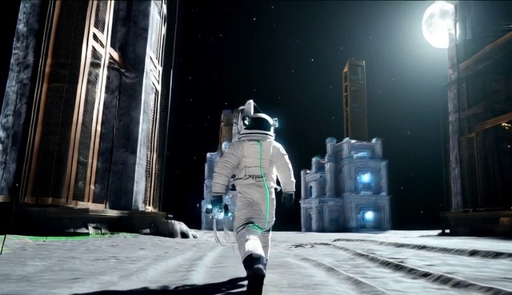
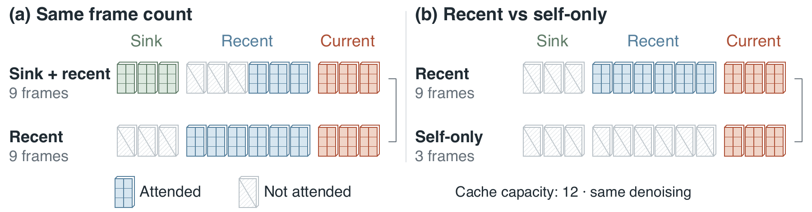

<div align="center">

<h1>What Helps Denoising Can Hurt Memory:<br>Rethinking History in Long Video Generation</h1>

**Commit Forcing: a training-free rule for what a long-video model writes into its KV cache.**

[](#news)&nbsp;
[](#supported-models)&nbsp;
[](RESULTS.md)&nbsp;
[](LICENSE)

</div>

## News

<table>
<tr><td></td><td><b>Initial release</b>: Code and evaluation results are available.</td></tr>
<tr><td></td><td><b>arXiv preprint</b></td></tr>
</table>

<p align="center">
  
</p>

<sub>Historical context has different effects when a block is denoised and when it is committed to the KV cache.</sub>

---

Block-causal video models use historical KV when denoising a block and again when constructing its clean KV for
future blocks. **Should the same history participate in both calls?** On LongLive, the sink helps denoising but
increases drift during committing. Historical sources also matter: recent trajectory frames improve motion
retention over replayed history. On SF with a sink and LongLive, retaining recent dependencies introduces a
continuity–motion tradeoff relative to self-only committing.
On SGF, excluding the sink improves Quality and long-range consistency even at the same read count;
relative to self-only, recent context improves smoothness and flicker without a significant Quality or consistency advantage.

**Commit Forcing** retains the base denoising policy and constructs clean KV from the current block and recent
trajectory frames. On SGF, it masks committing queries' direct access to sink KV; the sink remains stored and
available during denoising. The rule requires no training or additional model forwards. We evaluate 8 paired
configurations across 7 methods.

## Contributions

- **Stage differences.** We identify contrasting effects of the sink during denoising and committing through controlled
  stage interventions, showing that effective denoising context need not be effective committing context.
  ([LongLive stage analysis](analysis/longlive_sink/README.md))
- **Committing dependencies.** We compare historical sources during committing and identify the continuity–motion
  tradeoff of retaining recent dependencies relative to self-only committing.
  ([source comparison](analysis/committing_source/README.md), [recent versus self-only](analysis/commit_window/README.md))
- **Commit Forcing.** We propose training-free Commit Forcing and evaluate it across 8 configurations on 60-second
  VBench, with significant Quality and Total gains in 5, generation-seed replication, and comparisons up to 240 seconds.
  ([results](#results))

<p align="center">
  
</p>

<sub>In SGF, the denoising passes read the sink and the recent cache as in the base model; the commit pass at t = 0
reads the recent cache and the current block. The sink stays available to the next block's denoising.</sub>

## Results

**Main evaluation: full VBench, 60 s**, the common 946-entry suite, one video per entry (generation seed 0), all 16 dimensions.
Each row compares the same released weights with and without Commit Forcing. Native denoising and sampler settings
remain model-specific; the generation prompts and scoring protocol are shared. The committing adaptations are
described in [Supported models](#supported-models).

<table>
<thead>
<tr><th rowspan="2" align="left">Model</th><th colspan="3">Quality</th><th colspan="3">Total</th></tr>
<tr><th>Base</th><th>+ CF</th><th>Δ</th><th>Base</th><th>+ CF</th><th>Δ</th></tr>
</thead>
<tbody>
<tr><td>SGF</td><td align="right">86.06</td><td align="right">87.22</td><td align="right"><b>+1.16</b></td><td align="right">83.85</td><td align="right">84.94</td><td align="right"><b>+1.09</b></td></tr>
<tr><td>Recency Forcing, training-free †</td><td align="right">84.77</td><td align="right">85.24</td><td align="right"><b>+0.47</b></td><td align="right">82.24</td><td align="right">83.08</td><td align="right"><b>+0.85</b></td></tr>
<tr><td>Context Forcing</td><td align="right">84.79</td><td align="right">85.25</td><td align="right"><b>+0.46</b></td><td align="right">82.24</td><td align="right">82.68</td><td align="right"><b>+0.44</b></td></tr>
<tr><td>SGF+</td><td align="right">86.32</td><td align="right">86.61</td><td align="right">+0.29</td><td align="right">84.30</td><td align="right">84.60</td><td align="right">+0.30</td></tr>
<tr><td>LongLive</td><td align="right">84.70</td><td align="right">84.99</td><td align="right"><b>+0.29</b></td><td align="right">83.05</td><td align="right">83.36</td><td align="right"><b>+0.31</b></td></tr>
<tr><td>Rolling Sink</td><td align="right">84.84</td><td align="right">85.15</td><td align="right"><b>+0.32</b></td><td align="right">82.90</td><td align="right">83.18</td><td align="right"><b>+0.28</b></td></tr>
<tr><td>ID-Forcing on Self-Forcing</td><td align="right">85.26</td><td align="right">85.21</td><td align="right">−0.05</td><td align="right">82.96</td><td align="right">83.15</td><td align="right">+0.19</td></tr>
<tr><td>ID-Forcing on LongLive</td><td align="right">84.91</td><td align="right">84.64</td><td align="right">−0.27</td><td align="right">82.92</td><td align="right">82.91</td><td align="right">−0.01</td></tr>
</tbody>
</table>

Scores ×100. **+ CF**: + Commit Forcing; **Δ**: + CF − Base. Bold Δ marks statistically significant changes.
Quality combines seven visual dimensions; Total also includes nine semantic dimensions.
† RF-TF applies Recency Forcing's Temporal Response Bias to released Self-Forcing weights; it uses no RF-trained checkpoint.
Quality and Total improve significantly in 5 configurations. SGF has the largest Total gain, +1.09 points.
[All dimensions, intervals and protocol records](results/vbench_full/common946/README.md).
SGF's Quality gain is concentrated in motion retention: Dynamic Degree contributes 1.10 of its 1.16 points.
[Quality decomposition and measured cost](analysis/quality_cost/README.md).

**MovieGen cross-protocol check, 60 s videos**, 200 fixed [MovieGen prompts](eval/prompts/README.md), generation seed 0.
Quality combines VBench's seven visual dimensions using its official normalization and weights.

| Model | Base | + Commit Forcing | Δ Quality | Δ Consistency |
|:---|--:|--:|--:|--:|
| SGF | 83.58 | 84.62 | **+1.04** | **+4.40** |
| Recency Forcing, training-free † | 82.01 | 82.47 | **+0.46** | **+3.86** |
| LongLive | 82.23 | 82.73 | **+0.49** | **+1.20** |
| Context Forcing, sink exclusion | 82.78 | 83.11 | **+0.32** | **+1.80** |
| Context Forcing, full rule | 82.78 | 82.91 | +0.13 | **+3.23** |
| Rolling Sink | 82.61 | 82.72 | +0.11 | **+0.67** |
| Self-Forcing with sink | 81.33 | 81.63 | +0.31 | **+3.38** |

Base: the original model. + Commit Forcing: the same weights and initial noise, with Commit Forcing (no training).
Consistency: VBench-Long's clip-to-clip subject consistency, our measure of long-range consistency.
**bold Δ**: the paired 95% bootstrap interval excludes 0. All seven clip-to-clip Subject gains reproduce with generation
seed 1. [Both seeds and all metrics](RESULTS.md#committing-replication). SGF+, ID-Forcing and SGF + RF compatibility
comparisons remain in [RESULTS.md](RESULTS.md).

The standard suite scores dimension-specific subsets and applies VBench's static filter for Flickering.
The MovieGen evaluation scores all seven visual dimensions on each prompt and leaves Flickering unfiltered.
Each Base / + Commit Forcing pair shares its inputs and scoring settings.
LongLive uses 6-frame committing: 3 recent frames and the current 3-frame block.

**Longer videos, 120–240 s**, VBench-Long Quality. Compare within each prompt set:

| Model | Length | Prompts | Base | + Commit Forcing | Δ Quality | Δ Consistency |
|:---|:---|:---|--:|--:|--:|--:|
| SGF | 240 s | 32 MovieGen | 83.97 | 84.69 | **+0.72** | **+5.07** |
| Context Forcing | 240 s | 32 MovieGen | 83.60 | 84.04 | +0.44 | **+2.23** |
| LongLive, 6 frames | 120 s | 128 of ID-Forcing | 81.72 | 82.05 | **+0.33** | **+1.87** |
| LongLive, 12-frame control | 240 s | 128 of ID-Forcing | 81.56 | 81.84 | **+0.28** | **+1.96** |
| ID-Forcing on Self-Forcing | 240 s | 128 of ID-Forcing | 81.32 | 81.65 | **+0.34** | **+3.58** |

Intervals, the second seed, 120 s videos and every component score: **[RESULTS.md](RESULTS.md)**.
The 240-second LongLive 6-frame evaluation is pending; the 12-frame control is retained above.

## Qualitative comparisons

Each model without (Base) and with Commit Forcing, from the same prompt and initial noise. Start: 1 s, the same in
both videos; the other two frames are 2 s before the end.

<table>
<tr><th></th><th>Start (same in both)</th><th>Base</th><th>+ Commit Forcing</th></tr>
<tr><td><b>SGF</b><br>240 s<br><sub>MovieGen #3</sub><br><a href="assets/qualitative/sgf/comparison.mp4">video</a></td><td></td><td></td><td></td></tr>
<tr><td><b>LongLive</b><br>240 s<br><sub>12-frame control<br>ID-Forcing prompts #96</sub><br><a href="assets/qualitative/longlive/comparison.mp4">video</a></td><td></td><td></td><td></td></tr>
<tr><td><b>Context Forcing</b><br>60 s<br><sub>rollf200 #99</sub><br><a href="assets/qualitative/context-forcing/comparison.mp4">video</a></td><td></td><td></td><td></td></tr>
</table>

[All 7 examples →](assets/qualitative/README.md)

## Quickstart

### 1. Fetch the code

```bash
git clone https://github.com/Dwell-Jing/commit-forcing.git && cd commit-forcing
bash setup/fetch.sh sgf     # upstream code at the tested commit, with our patch, in third_party/sgf
```

Install the [tested environment](setup/README.md) and download the weights as described in each
[integration README](#supported-models).

### 2. Generate

```bash
python integrations/sgf/generate.py --code third_party/sgf --reading native --rule on \
    --prompts eval/prompts/rollf200.txt --ids 0-199 --seconds 60 --seed 0 --out outputs/sgf
```

- Run it again with `--rule off` for the base model; videos go to `outputs/sgf/native/rule_<on|off>/seed0/`.
- Each video has a JSON sidecar with the activation counters, the motion of the frames and `frames_md5`, the md5 of
  the frames before mp4 encoding.
- The noise of prompt `i` under seed `s` comes from `torch.manual_seed(s * 100003 + i)`.

### 3. Evaluate

```bash
python eval/vbench_long/prep.py --vbench VBench --videos outputs/sgf/native/rule_off --label sgf --work vb_work
python eval/vbench_long/prep.py --vbench VBench --videos outputs/sgf/native/rule_on --label sgf+rule --work vb_work
bash eval/vbench_long/score.sh VBench vb_work 0     # start one copy per GPU
python eval/vbench_long/collect.py --work vb_work --label sgf --out scores.csv
python eval/vbench_long/collect.py --work vb_work --label sgf+rule --out scores.csv --append
python eval/vbench_long/compare.py --scores scores.csv --seed 0 --pair sgf+rule:sgf
```

The [VBench-Long pipeline](eval/vbench_long/README.md) gives the setup (VBench @45e79ec) and the statistics; the
[full-VBench pipeline](eval/vbench_full/README.md) scores the 946-prompt suite.

### 4. Reproduce our tables

```bash
python eval/vbench_full/reproduce_common946.py
python assets/source/make_commit_effects.py --check-only
```

These commands verify the main VBench scores and the two-seed committing figure. Inputs and reproduction commands
for the other comparisons are listed in [RESULTS.md](RESULTS.md) and [results/](results/README.md).

## Supported models

| Model | Upstream code | Commit pass reads: Base | + Commit Forcing |
|:---|:---|:---|:---|
| [SGF](integrations/sgf/README.md) | [Self_Gradient_Forcing](https://github.com/zhuang2002/Self_Gradient_Forcing) | sink + recent frames | newest 9 frames |
| [SGF+](integrations/sgf_plus/README.md) | [Self_Gradient_Forcing_Plus](https://github.com/Zihan-Su/Self_Gradient_Forcing_Plus) | sink + recent frames | newest 9 frames |
| [Recency Forcing](integrations/recency_forcing/README.md) | [Self-Forcing](https://github.com/guandeh17/Self-Forcing) | sink 3 + newest 18 frames | newest 21 frames |
| [LongLive](integrations/longlive/README.md) | [LongLive](https://github.com/NVlabs/LongLive) | sink 3 + newest 9 frames | newest 6 frames |
| [Context Forcing](integrations/context_forcing/README.md) | [Context-Forcing](https://github.com/chenshuo20/Context-Forcing) | sink + slow memory + fast window | fast window |
| [Rolling Sink](integrations/rolling_sink/README.md) | [Rolling-Sink](https://github.com/Rolling-Sink/Rolling-Sink) | replayed history | real committed history |
| [ID-Forcing](integrations/id_forcing/README.md) | [ID-Forcing](https://github.com/In-Distribution-Forcing/ID-Forcing) | the chunk itself | the 2 previous chunks + the chunk |

The last two columns list what the commit pass reads. Each folder holds the patch (ID-Forcing: none; we import its code
from your checkout), `generate.py` and a README with the setup and the activation counters that confirm Commit Forcing
is on.

On ID-Forcing/Self-Forcing, the adaptation also retains the original handover KV and omits recurrent tail re-encoding.
LongLive's standard-suite comparison uses 6-frame committing with 12 physical cache frames in both arms.
The earlier custom-prompt runs use 15 physical frames in both arms; the 12-frame committing variant remains a control.
Recent history is defined by its original time in the generated trajectory; replaying an old
frame into a nearby cache slot does not make it recent.

## Mechanism analyses

| Committing question | Analysis |
|:---|:---|
| How does sink access differ across stages? | [LongLive stage interventions](analysis/longlive_sink/README.md) |
| Does the source of history matter? | [Rolling Sink sources](analysis/committing_source/README.md) · [SGF equal-count control](analysis/sgf_committing_controls/README.md) |
| What does recent context retain over self-only? | [Continuity and motion tradeoffs](analysis/commit_window/README.md) |
| How does recent context work within ID-Forcing? | [Cache-construction comparisons](analysis/not_ood/README.md) |
| How many frames should the commit pass read? | [Commit window](analysis/commit_window/README.md) |
| What contributes to the score and computational cost? | [Quality decomposition and inference measurements](analysis/quality_cost/README.md) |

<p align="center">
  
</p>

Both 9-frame contexts use the same 12-frame physical cache and base denoising. Recent-only improves Quality by
1.25 and clip-to-clip Subject by 4.54 points over sink plus recent. Against self-only, neither gain is significant;
recent context improves smoothness and flicker while reducing Dynamic Degree.
[Four groups, both seeds and reproduction](analysis/sgf_committing_controls/README.md).

Supplementary observations: [switching the committing context](analysis/commit_switch/README.md) and
[SGF + RF-TF compatibility](RESULTS.md#sgf-rf-compatibility).
[DINOv2 Own/Sibling components](analysis/similarity_components/README.md) separate the appearance-similarity terms.

### Independent denoising studies

[Step, layer and content interventions](analysis/read_locus/README.md),
[SGF boundary controls](analysis/boundaries/sgf/README.md) and the [historical mechanism figure](assets/mechanisms/README.md)
belong to the separate distant-history reading study. Their data, code, negative results and visual costs remain
available. [Diagnostic metrics](analysis/metrics/README.md) defines the associated identity, color and motion readouts.

## Read more

| | |
|---|---|
| **[RESULTS.md](RESULTS.md)** | every result table: 60 s (2 seeds), full VBench, 120 s and 240 s |
| [results/](results/README.md) | per-video score CSVs, table specs and exact outputs |
| [eval/vbench_long](eval/vbench_long/README.md) · [eval/vbench_full](eval/vbench_full/README.md) | the two evaluation pipelines |
| [analysis/](#mechanism-analyses) | the mechanism studies, their data and generators |
| [assets/qualitative](assets/qualitative/README.md) | paired early / late frames and comparison videos |
| [setup/](setup/README.md) | fetching upstream code and the tested environment |
| [NOTICE](NOTICE) | upstream projects and their licenses |

## License

Code is Apache-2.0 ([LICENSE](LICENSE)), except `integrations/rolling_sink` (Adobe Research License) and
`integrations/context_forcing` (CC BY-NC-SA 4.0), which are for non-commercial research ([NOTICE](NOTICE)).
Questions: open an [issue](https://github.com/Dwell-Jing/commit-forcing/issues).
