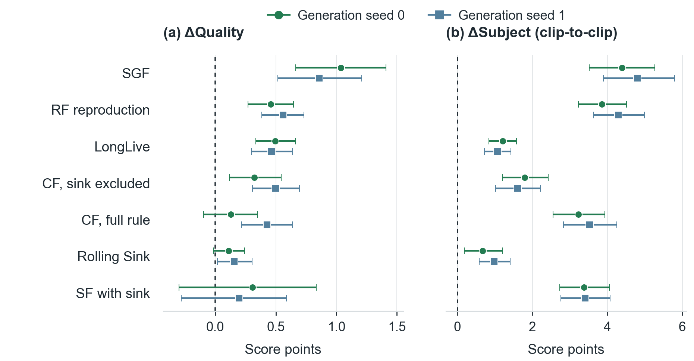

# Results

Scores ×100 unless stated otherwise. **Base** is the original generator. **Commit Forcing** in the current main evaluation uses
the clean current block plus stored KV of the immediately preceding block,
3 + 3 latent frames after startup. Base denoising, cache storage and update remain in place. Other history is
excluded from direct committing access but can still influence the generated block and preceding-block KV.

**Δ** is the paired difference over prompts with its 95% bootstrap interval (4,000 draws); `*` marks an interval
excluding 0. Differences are computed before rounding. **Consistency** is VBench-Long's clip-to-clip Subject
Consistency, its interclip component. [Mapping and fusion](eval/vbench_long/README.md) define its relation to the
combined Subject score. † RF-TF applies the public Recency Forcing Temporal Response Bias to released Self-Forcing weights,
without an RF-trained checkpoint. Wider-context studies are labelled as supporting controls below.

[Full VBench](#full-vbench) · [ID-Forcing framework comparisons](#id-forcing-framework-comparisons) ·
[MovieGen 60 s](#60-s-videos) · [Longer videos](#longer-videos) · [Committing controls](#committing-controls) ·
[Current six-frame custom-prompt results](#current-six-frame-custom-prompt-results) · [Committing window](#committing-window) · [Committing variants](#committing-variants) ·
[KV construction](#kv-construction-controls) · [Transfer boundaries](#transfer-boundaries) ·
[Human evaluation](results/human_evaluation/README.md) · [Quality and cost](analysis/quality_cost/README.md) ·
[per-video data and commands](results/README.md) · [← Home](README.md)

## Full VBench

**Current main protocol:** 946 metadata entries, 944 distinct original prompts, one nominal 60-second video per
entry (generation seed 0), six paired generators and all 16 dimensions. Generation uses Wan-expanded prompts;
scoring uses original VBench metadata, dimension-specific subsets and the official Flickering filter. Each pair
retains its released weights and base denoising/sampler/storage settings. All adapted arms commit from the current
and immediately preceding blocks. SGF+ uses its official 12-frame physical configuration; LongLive stores
12 physical cache frames in both arms.

<table>
<thead>
<tr><th rowspan="2" align="left">Model</th><th colspan="3">Quality</th><th colspan="3">Total</th></tr>
<tr><th>Base</th><th>Commit Forcing</th><th>Δ</th><th>Base</th><th>Commit Forcing</th><th>Δ</th></tr>
</thead>
<tbody>
<tr><td>Context Forcing</td><td align="right">84.79</td><td align="right">85.25</td><td align="right"><b>+0.46</b></td><td align="right">82.24</td><td align="right">82.68</td><td align="right"><b>+0.44</b></td></tr>
<tr><td>Rolling Sink</td><td align="right">84.84</td><td align="right">85.25</td><td align="right"><b>+0.41</b></td><td align="right">82.90</td><td align="right">83.26</td><td align="right"><b>+0.36</b></td></tr>
<tr><td>Recency Forcing, training-free †</td><td align="right">84.77</td><td align="right">85.42</td><td align="right"><b>+0.65</b></td><td align="right">82.24</td><td align="right">83.34</td><td align="right"><b>+1.10</b></td></tr>
<tr><td>LongLive</td><td align="right">84.70</td><td align="right">84.99</td><td align="right"><b>+0.29</b></td><td align="right">83.05</td><td align="right">83.36</td><td align="right"><b>+0.31</b></td></tr>
<tr><td>SGF+</td><td align="right">86.32</td><td align="right">86.63</td><td align="right">+0.32</td><td align="right">84.30</td><td align="right">84.64</td><td align="right">+0.34</td></tr>
<tr><td>SGF</td><td align="right">86.06</td><td align="right">87.33</td><td align="right"><b>+1.27</b></td><td align="right">83.85</td><td align="right">84.82</td><td align="right"><b>+0.98</b></td></tr>
</tbody>
</table>

Rows follow ascending adapted Total. Bold Δ marks a paired 95% interval excluding 0. On this 60-second standard
suite, Quality and Total improve significantly on 5 of 6 generators; all six point estimates are positive.
RF-TF has the largest Total increase, +1.10 points. SGF has the largest Quality increase, +1.27 points.
On the separate 200-prompt rollf200 evaluation, SGF's raw Subject c2c gain is +4.76 points. The estimate after
descriptive regression adjustment is +4.87 points. The adjustment uses paired Dynamic Degree differences; its protocol and interval are recorded below.
Standard-suite intervals use 4,000 paired draws over 944 original-prompt clusters, retaining each arm's official surviving-record
weights, including its own Flickering filter and omitted Color records.
Current intervals are frozen as reported. The [current source summaries and historical raw package](results/vbench_full/common946/README.md)
provide point-estimate checks for the current method and full bootstrap replay for the preserved historical package.

Current main evaluation: all 16 dimensions and aggregate intervals

**Context Forcing — 6-frame committing**

| Metric | Base | Commit Forcing | Δ [95% CI] |
|:---|---:|---:|:---|
| Quality | 84.79 | 85.25 | +0.46* [+0.09, +0.85] |
| Semantic | 72.03 | 72.41 | +0.38 [−0.49, +1.25] |
| Total | 82.24 | 82.68 | +0.44* [+0.10, +0.81] |
| Subject consistency | 97.75 | 97.96 | +0.21* [+0.07, +0.37] |
| Background consistency | 96.63 | 96.92 | +0.29* [+0.19, +0.40] |
| Temporal flickering | 99.30 | 99.21 | −0.09* [−0.14, −0.04] |
| Motion smoothness | 98.55 | 98.43 | −0.12* [−0.21, −0.02] |
| Dynamic degree | 58.89 | 62.31 | +3.43 [−1.32, +8.20] |
| Aesthetic quality | 65.41 | 65.82 | +0.41 [−0.02, +0.85] |
| Imaging quality | 69.47 | 70.32 | +0.84* [+0.30, +1.41] |
| Object class | 88.63 | 87.23 | −1.40 [−4.42, +1.23] |
| Multiple objects | 70.79 | 73.34 | +2.55 [−0.97, +6.33] |
| Human action | 91.33 | 93.67 | +2.33* [+0.46, +4.56] |
| Color | 84.31 | 85.09 | +0.77 [−2.27, +3.74] |
| Spatial relationship | 69.19 | 67.40 | −1.79 [−5.12, +1.25] |
| Scene | 40.20 | 39.47 | −0.73 [−4.02, +2.55] |
| Appearance style | 20.88 | 20.97 | +0.09 [−0.07, +0.24] |
| Temporal style | 20.83 | 21.10 | +0.26 [−0.01, +0.52] |
| Overall consistency | 23.60 | 23.89 | +0.29 [−0.02, +0.61] |

**Rolling Sink — 6-frame committing**

| Metric | Base | Commit Forcing | Δ [95% CI] |
|:---|---:|---:|:---|
| Quality | 84.84 | 85.25 | +0.41* [+0.15, +0.69] |
| Semantic | 75.13 | 75.31 | +0.17 [−0.53, +0.88] |
| Total | 82.90 | 83.26 | +0.36* [+0.10, +0.63] |
| Subject consistency | 98.09 | 98.28 | +0.18* [+0.04, +0.34] |
| Background consistency | 97.07 | 97.34 | +0.27* [+0.19, +0.36] |
| Temporal flickering | 99.11 | 99.06 | −0.05* [−0.11, −0.00] |
| Motion smoothness | 98.77 | 98.66 | −0.11* [−0.21, −0.03] |
| Dynamic degree | 53.94 | 57.41 | +3.47* [+0.64, +6.44] |
| Aesthetic quality | 65.53 | 66.02 | +0.49* [+0.06, +0.95] |
| Imaging quality | 70.88 | 71.28 | +0.40 [−0.31, +1.20] |
| Object class | 89.97 | 89.85 | −0.12 [−1.32, +0.91] |
| Multiple objects | 74.51 | 74.31 | −0.21 [−2.88, +2.18] |
| Human action | 91.17 | 90.67 | −0.50 [−3.33, +2.28] |
| Color | 91.58 | 92.98 | +1.40 [−1.36, +4.33] |
| Spatial relationship | 72.81 | 73.46 | +0.65 [−1.35, +2.58] |
| Scene | 42.81 | 43.63 | +0.82 [−1.98, +3.66] |
| Appearance style | 20.77 | 20.74 | −0.03 [−0.17, +0.10] |
| Temporal style | 22.85 | 22.71 | −0.14* [−0.28, −0.00] |
| Overall consistency | 24.98 | 24.92 | −0.06 [−0.34, +0.15] |

**RF-TF † — 6-frame committing**

| Metric | Base | Commit Forcing | Δ [95% CI] |
|:---|---:|---:|:---|
| Quality | 84.77 | 85.42 | +0.65* [+0.27, +1.01] |
| Semantic | 72.10 | 75.00 | +2.90* [+1.97, +3.82] |
| Total | 82.24 | 83.34 | +1.10* [+0.74, +1.45] |
| Subject consistency | 96.73 | 97.36 | +0.63* [+0.44, +0.82] |
| Background consistency | 95.92 | 96.70 | +0.77* [+0.67, +0.88] |
| Temporal flickering | 98.88 | 98.96 | +0.09* [+0.03, +0.16] |
| Motion smoothness | 98.37 | 98.31 | −0.05 [−0.14, +0.03] |
| Dynamic degree | 70.28 | 67.36 | −2.92 [−7.67, +1.60] |
| Aesthetic quality | 62.65 | 65.03 | +2.38* [+1.75, +3.04] |
| Imaging quality | 70.34 | 71.82 | +1.48* [+0.72, +2.28] |
| Object class | 88.05 | 90.49 | +2.44 [−0.22, +5.64] |
| Multiple objects | 63.58 | 70.46 | +6.88* [+3.20, +10.56] |
| Human action | 92.83 | 94.67 | +1.83 [−0.35, +4.26] |
| Color | 87.96 | 89.78 | +1.82 [−1.13, +4.56] |
| Spatial relationship | 73.15 | 75.76 | +2.61 [−0.68, +5.64] |
| Scene | 35.47 | 43.01 | +7.55* [+3.61, +11.75] |
| Appearance style | 20.66 | 20.60 | −0.06 [−0.27, +0.16] |
| Temporal style | 21.96 | 22.36 | +0.40* [+0.03, +0.78] |
| Overall consistency | 24.59 | 24.77 | +0.18 [−0.14, +0.49] |

**LongLive — 6-frame committing**

| Metric | Base | Commit Forcing | Δ [95% CI] |
|:---|---:|---:|:---|
| Quality | 84.70 | 84.99 | +0.29* [+0.05, +0.52] |
| Semantic | 76.43 | 76.84 | +0.41 [−0.09, +0.91] |
| Total | 83.05 | 83.36 | +0.31* [+0.10, +0.52] |
| Subject consistency | 97.96 | 98.00 | +0.05 [−0.06, +0.15] |
| Background consistency | 97.11 | 97.23 | +0.12* [+0.06, +0.19] |
| Temporal flickering | 99.29 | 99.28 | −0.01 [−0.04, +0.02] |
| Motion smoothness | 98.69 | 98.55 | −0.14* [−0.20, −0.08] |
| Dynamic degree | 52.13 | 54.81 | +2.69 [−0.38, +5.65] |
| Aesthetic quality | 66.30 | 66.71 | +0.40* [+0.12, +0.70] |
| Imaging quality | 70.03 | 70.46 | +0.42* [+0.11, +0.72] |
| Object class | 89.18 | 88.52 | −0.65 [−2.02, +0.58] |
| Multiple objects | 78.40 | 79.91 | +1.51* [+0.10, +3.17] |
| Human action | 94.83 | 95.50 | +0.67 [−0.64, +2.14] |
| Color | 92.17 | 92.04 | −0.13 [−1.49, +1.35] |
| Spatial relationship | 75.80 | 76.30 | +0.50 [−1.70, +2.70] |
| Scene | 44.77 | 45.71 | +0.94 [−1.20, +3.17] |
| Appearance style | 20.69 | 20.73 | +0.04 [−0.06, +0.14] |
| Temporal style | 22.49 | 22.65 | +0.16* [+0.04, +0.30] |
| Overall consistency | 25.08 | 25.09 | +0.02 [−0.10, +0.13] |

**SGF+ — 6-frame committing**

| Metric | Base | Commit Forcing | Δ [95% CI] |
|:---|---:|---:|:---|
| Quality | 86.32 | 86.63 | +0.32 [−0.15, +0.81] |
| Semantic | 76.22 | 76.66 | +0.45 [−0.20, +1.13] |
| Total | 84.30 | 84.64 | +0.34 [−0.07, +0.76] |
| Subject consistency | 98.51 | 98.81 | +0.30* [+0.20, +0.41] |
| Background consistency | 96.93 | 97.53 | +0.61* [+0.51, +0.70] |
| Temporal flickering | 99.23 | 99.32 | +0.10* [+0.03, +0.16] |
| Motion smoothness | 98.75 | 98.67 | −0.09* [−0.17, −0.01] |
| Dynamic degree | 64.86 | 66.48 | +1.62 [−4.73, +8.25] |
| Aesthetic quality | 67.86 | 68.10 | +0.24 [−0.07, +0.56] |
| Imaging quality | 72.17 | 72.04 | −0.13 [−0.56, +0.29] |
| Object class | 87.61 | 87.89 | +0.28 [−0.49, +1.18] |
| Multiple objects | 77.62 | 79.00 | +1.39 [−0.60, +3.74] |
| Human action | 91.83 | 93.33 | +1.50 [−0.17, +3.65] |
| Color | 89.74 | 89.55 | −0.19 [−2.84, +2.20] |
| Spatial relationship | 79.78 | 77.27 | −2.51 [−5.40, +0.18] |
| Scene | 47.11 | 49.55 | +2.45 [−0.27, +5.61] |
| Appearance style | 20.65 | 20.72 | +0.08 [−0.03, +0.19] |
| Temporal style | 22.44 | 22.54 | +0.10 [−0.07, +0.26] |
| Overall consistency | 24.82 | 24.84 | +0.02 [−0.15, +0.19] |

**SGF — 6-frame committing**

| Metric | Base | Commit Forcing | Δ [95% CI] |
|:---|---:|---:|:---|
| Quality | 86.06 | 87.33 | +1.27* [+0.76, +1.88] |
| Semantic | 74.99 | 74.78 | −0.21 [−1.62, +1.18] |
| Total | 83.85 | 84.82 | +0.98* [+0.45, +1.53] |
| Subject consistency | 98.26 | 98.51 | +0.25* [+0.10, +0.40] |
| Background consistency | 96.69 | 97.17 | +0.48* [+0.34, +0.63] |
| Temporal flickering | 98.95 | 98.99 | +0.04 [−0.06, +0.14] |
| Motion smoothness | 98.63 | 98.35 | −0.29* [−0.40, −0.17] |
| Dynamic degree | 67.45 | 80.56 | +13.10* [+6.38, +20.50] |
| Aesthetic quality | 67.06 | 68.20 | +1.15* [+0.46, +1.92] |
| Imaging quality | 71.82 | 72.32 | +0.50 [−0.25, +1.27] |
| Object class | 86.00 | 90.82 | +4.82* [+0.94, +9.51] |
| Multiple objects | 71.24 | 71.72 | +0.48 [−5.18, +6.12] |
| Human action | 92.33 | 91.50 | −0.83 [−5.68, +3.82] |
| Color | 89.60 | 87.71 | −1.90 [−5.93, +2.00] |
| Spatial relationship | 76.29 | 74.20 | −2.09 [−7.02, +2.62] |
| Scene | 48.09 | 44.73 | −3.36 [−9.20, +2.40] |
| Appearance style | 20.61 | 20.76 | +0.15 [−0.10, +0.38] |
| Temporal style | 22.05 | 22.35 | +0.30 [−0.06, +0.68] |
| Overall consistency | 24.84 | 24.97 | +0.13 [−0.27, +0.54] |

## ID-Forcing framework comparisons

These separate 9-frame adaptations use 6 historical frames plus the current 3-frame block within ID-Forcing.
They differ from the 6-frame main method. The Self-Forcing adaptation also changes cache handover and omits
recurrent tail recaching. Quality and Total intervals include 0 on both backbones; Semantic increases on both.
Dynamic Degree decreases by 3.80 points on Self-Forcing and 6.16 on LongLive, with intervals excluding 0.

| Framework | Score | Base | 9-frame adaptation | Δ [95% CI] |
|:---|:---|---:|---:|:---|
| ID-Forcing on Self-Forcing | Quality | 85.26 | 85.21 | −0.05 [−0.30, +0.19] |
| | Semantic | 73.76 | 74.90 | +1.14* [+0.39, +1.91] |
| | Total | 82.96 | 83.15 | +0.19 [−0.07, +0.43] |
| ID-Forcing on LongLive | Quality | 84.91 | 84.64 | −0.27 [−0.61, +0.05] |
| | Semantic | 74.93 | 75.98 | +1.05* [+0.35, +1.75] |
| | Total | 82.92 | 82.91 | −0.01 [−0.32, +0.29] |

The preserved package below retains all component scores, intervals and protocol records for these adaptations.

Historical common946 package: original 8 pairs and LongLive 12-frame control

SGF and SGF+ use 9-frame controls; RF-TF and Rolling Sink use 21-frame controls. CF and LongLive use 6 frames.
The two ID-Forcing adaptations use 9 frames. The frozen raw 16-arm package and its scores are preserved; this
foldout does not substitute these contexts for the current six-generator method.

**Historical common946 protocol:** 946 VBench entries, one nominal 60 s video per entry, all 16 dimensions.
This preserved package contains 8 paired configurations, including the two 9-frame ID-Forcing adaptations.
Each pair uses the same released weights, prompt and per-prompt seed. Native denoising and sampler settings remain
model-specific; SGF+ uses its official 12-frame configuration. LongLive uses 6-frame committing and 12 physical
cache frames in both arms. IDF-SF changes handover and tail recaching, as documented in the integration READMEs.
Generation uses Wan-expanded prompts; scoring uses their original VBench metadata and dimension-specific subsets.

<table>
<thead>
<tr><th rowspan="2" align="left">Model</th><th colspan="3">Quality</th><th colspan="3">Total</th></tr>
<tr><th>Base</th><th>Recent-context control</th><th>Δ</th><th>Base</th><th>Recent-context control</th><th>Δ</th></tr>
</thead>
<tbody>
<tr><td>Context Forcing</td><td align="right">84.79</td><td align="right">85.25</td><td align="right"><b>+0.46</b></td><td align="right">82.24</td><td align="right">82.68</td><td align="right"><b>+0.44</b></td></tr>
<tr><td>ID-Forcing on LongLive</td><td align="right">84.91</td><td align="right">84.64</td><td align="right">−0.27</td><td align="right">82.92</td><td align="right">82.91</td><td align="right">−0.01</td></tr>
<tr><td>Recency Forcing, training-free †</td><td align="right">84.77</td><td align="right">85.24</td><td align="right"><b>+0.47</b></td><td align="right">82.24</td><td align="right">83.08</td><td align="right"><b>+0.85</b></td></tr>
<tr><td>ID-Forcing on Self-Forcing</td><td align="right">85.26</td><td align="right">85.21</td><td align="right">−0.05</td><td align="right">82.96</td><td align="right">83.15</td><td align="right">+0.19</td></tr>
<tr><td>Rolling Sink</td><td align="right">84.84</td><td align="right">85.15</td><td align="right"><b>+0.32</b></td><td align="right">82.90</td><td align="right">83.18</td><td align="right"><b>+0.28</b></td></tr>
<tr><td>LongLive</td><td align="right">84.70</td><td align="right">84.99</td><td align="right"><b>+0.29</b></td><td align="right">83.05</td><td align="right">83.36</td><td align="right"><b>+0.31</b></td></tr>
<tr><td>SGF+</td><td align="right">86.32</td><td align="right">86.61</td><td align="right">+0.29</td><td align="right">84.30</td><td align="right">84.60</td><td align="right">+0.30</td></tr>
<tr><td>SGF</td><td align="right">86.06</td><td align="right">87.22</td><td align="right"><b>+1.16</b></td><td align="right">83.85</td><td align="right">84.94</td><td align="right"><b>+1.09</b></td></tr>
</tbody>
</table>

Intervals use 4,000 paired bootstrap draws of 944 distinct original-prompt clusters (seed 20261011).
Aggregation retains each arm's official output-record weights, including its own Flickering filter and omitted Color records.
This historical package updated the earlier three-model summary with consistent denominators; earlier CSVs and specs remain under
[`results/vbench_full`](results/vbench_full/README.md).
Rows follow Total with recent-context control, in ascending order. In this historical package, Quality and Total improve significantly in 5 of the 8 configurations.
Unrounded scores, all component intervals, coverage, configuration records and the CPU reproduction command:
[`common946`](results/vbench_full/common946/README.md).

All 16 dimensions and aggregate scores, each backbone paired with itself

**SGF**

| Metric | Base | + recent-context control | Δ [95% CI] |
|:---|---:|---:|:---|
| Quality | 86.06 | 87.22 | +1.16* [+0.57, +1.81] |
| Semantic | 74.99 | 75.79 | +0.80 [−0.61, +2.24] |
| Total | 83.85 | 84.94 | +1.09* [+0.56, +1.66] |
| Subject consistency | 98.26 | 98.43 | +0.17* [+0.04, +0.29] |
| Background consistency | 96.69 | 97.08 | +0.40* [+0.27, +0.53] |
| Temporal flickering | 98.95 | 98.78 | −0.16* [−0.28, −0.05] |
| Motion smoothness | 98.63 | 98.37 | −0.26* [−0.36, −0.16] |
| Dynamic degree | 67.45 | 81.81 | +14.35* [+6.93, +22.37] |
| Aesthetic quality | 67.06 | 67.52 | +0.46 [−0.24, +1.16] |
| Imaging quality | 71.82 | 72.32 | +0.50 [−0.29, +1.28] |
| Object class | 86.00 | 85.51 | −0.49 [−4.12, +2.87] |
| Multiple objects | 71.24 | 77.01 | +5.76 [−0.74, +12.10] |
| Human action | 92.33 | 91.83 | −0.50 [−5.12, +4.03] |
| Color | 89.60 | 88.91 | −0.69 [−6.06, +4.14] |
| Spatial relationship | 76.29 | 75.76 | −0.53 [−6.03, +5.00] |
| Scene | 48.09 | 51.04 | +2.95 [−1.68, +7.80] |
| Appearance style | 20.61 | 20.77 | +0.16 [−0.07, +0.38] |
| Temporal style | 22.05 | 22.33 | +0.28 [−0.08, +0.67] |
| Overall consistency | 24.84 | 24.37 | −0.47* [−0.95, −0.02] |

**Recency Forcing, training-free †**

| Metric | Base | + recent-context control | Δ [95% CI] |
|:---|---:|---:|:---|
| Quality | 84.77 | 85.24 | +0.47* [+0.16, +0.79] |
| Semantic | 72.10 | 74.44 | +2.35* [+1.57, +3.09] |
| Total | 82.24 | 83.08 | +0.85* [+0.54, +1.16] |
| Subject consistency | 96.73 | 96.98 | +0.26* [+0.09, +0.42] |
| Background consistency | 95.92 | 96.23 | +0.30* [+0.23, +0.37] |
| Temporal flickering | 98.88 | 99.02 | +0.14* [+0.09, +0.21] |
| Motion smoothness | 98.37 | 98.23 | −0.14* [−0.24, −0.05] |
| Dynamic degree | 70.28 | 70.56 | +0.28 [−3.33, +4.02] |
| Aesthetic quality | 62.65 | 64.06 | +1.41* [+0.91, +1.96] |
| Imaging quality | 70.34 | 71.24 | +0.90* [+0.26, +1.57] |
| Object class | 88.05 | 89.04 | +1.00 [−1.62, +3.45] |
| Multiple objects | 63.58 | 69.33 | +5.75* [+2.52, +8.88] |
| Human action | 92.83 | 94.17 | +1.33 [+0.00, +2.66] |
| Color | 87.96 | 89.27 | +1.31 [−0.74, +3.36] |
| Spatial relationship | 73.15 | 74.82 | +1.67 [−1.32, +4.77] |
| Scene | 35.47 | 41.53 | +6.06* [+3.10, +9.32] |
| Appearance style | 20.66 | 20.56 | −0.10 [−0.23, +0.05] |
| Temporal style | 21.96 | 22.62 | +0.66* [+0.29, +1.06] |
| Overall consistency | 24.59 | 25.03 | +0.44* [+0.17, +0.70] |

**Context Forcing**

| Metric | Base | + recent-context control | Δ [95% CI] |
|:---|---:|---:|:---|
| Quality | 84.79 | 85.25 | +0.46* [+0.09, +0.85] |
| Semantic | 72.03 | 72.41 | +0.38 [−0.49, +1.25] |
| Total | 82.24 | 82.68 | +0.44* [+0.10, +0.81] |
| Subject consistency | 97.75 | 97.96 | +0.21* [+0.07, +0.37] |
| Background consistency | 96.63 | 96.92 | +0.29* [+0.19, +0.40] |
| Temporal flickering | 99.30 | 99.21 | −0.09* [−0.14, −0.04] |
| Motion smoothness | 98.55 | 98.43 | −0.12* [−0.21, −0.02] |
| Dynamic degree | 58.89 | 62.31 | +3.43 [−1.32, +8.20] |
| Aesthetic quality | 65.41 | 65.82 | +0.41 [−0.02, +0.85] |
| Imaging quality | 69.47 | 70.32 | +0.84* [+0.30, +1.41] |
| Object class | 88.63 | 87.23 | −1.40 [−4.42, +1.23] |
| Multiple objects | 70.79 | 73.34 | +2.55 [−0.97, +6.33] |
| Human action | 91.33 | 93.67 | +2.33* [+0.46, +4.56] |
| Color | 84.31 | 85.09 | +0.77 [−2.27, +3.74] |
| Spatial relationship | 69.19 | 67.40 | −1.79 [−5.12, +1.25] |
| Scene | 40.20 | 39.47 | −0.73 [−4.02, +2.55] |
| Appearance style | 20.88 | 20.97 | +0.09 [−0.07, +0.24] |
| Temporal style | 20.83 | 21.10 | +0.26 [−0.01, +0.52] |
| Overall consistency | 23.60 | 23.89 | +0.29 [−0.02, +0.61] |

**SGF+**

| Metric | Base | + recent-context control | Δ [95% CI] |
|:---|---:|---:|:---|
| Quality | 86.32 | 86.61 | +0.29 [−0.19, +0.78] |
| Semantic | 76.22 | 76.56 | +0.34 [−0.27, +0.96] |
| Total | 84.30 | 84.60 | +0.30 [−0.10, +0.71] |
| Subject consistency | 98.51 | 98.75 | +0.25* [+0.17, +0.33] |
| Background consistency | 96.93 | 97.49 | +0.56* [+0.47, +0.66] |
| Temporal flickering | 99.23 | 99.31 | +0.08* [+0.02, +0.14] |
| Motion smoothness | 98.75 | 98.66 | −0.09* [−0.18, −0.01] |
| Dynamic degree | 64.86 | 66.57 | +1.71 [−4.56, +8.22] |
| Aesthetic quality | 67.86 | 68.06 | +0.20 [−0.11, +0.51] |
| Imaging quality | 72.17 | 72.07 | −0.10 [−0.53, +0.31] |
| Object class | 87.61 | 88.04 | +0.43 [−0.35, +1.35] |
| Multiple objects | 77.62 | 79.04 | +1.43 [−0.72, +3.89] |
| Human action | 91.83 | 93.33 | +1.50 [−0.14, +3.61] |
| Color | 89.74 | 89.17 | −0.58 [−2.90, +1.27] |
| Spatial relationship | 79.78 | 77.81 | −1.97 [−4.76, +0.67] |
| Scene | 47.11 | 48.51 | +1.41 [−0.98, +4.01] |
| Appearance style | 20.65 | 20.72 | +0.07 [−0.04, +0.18] |
| Temporal style | 22.44 | 22.54 | +0.10 [−0.08, +0.28] |
| Overall consistency | 24.82 | 24.83 | +0.01 [−0.16, +0.17] |

**LongLive (6-frame committing)**

| Metric | Base | + recent-context control | Δ [95% CI] |
|:---|---:|---:|:---|
| Quality | 84.70 | 84.99 | +0.29* [+0.05, +0.52] |
| Semantic | 76.43 | 76.84 | +0.41 [−0.09, +0.91] |
| Total | 83.05 | 83.36 | +0.31* [+0.10, +0.52] |
| Subject consistency | 97.96 | 98.00 | +0.05 [−0.06, +0.15] |
| Background consistency | 97.11 | 97.23 | +0.12* [+0.06, +0.19] |
| Temporal flickering | 99.29 | 99.28 | −0.01 [−0.04, +0.02] |
| Motion smoothness | 98.69 | 98.55 | −0.14* [−0.20, −0.08] |
| Dynamic degree | 52.13 | 54.81 | +2.69 [−0.38, +5.65] |
| Aesthetic quality | 66.30 | 66.71 | +0.40* [+0.12, +0.70] |
| Imaging quality | 70.03 | 70.46 | +0.42* [+0.11, +0.72] |
| Object class | 89.18 | 88.52 | −0.65 [−2.02, +0.58] |
| Multiple objects | 78.40 | 79.91 | +1.51* [+0.10, +3.17] |
| Human action | 94.83 | 95.50 | +0.67 [−0.64, +2.14] |
| Color | 92.17 | 92.04 | −0.13 [−1.49, +1.35] |
| Spatial relationship | 75.80 | 76.30 | +0.50 [−1.70, +2.70] |
| Scene | 44.77 | 45.71 | +0.94 [−1.20, +3.17] |
| Appearance style | 20.69 | 20.73 | +0.04 [−0.06, +0.14] |
| Temporal style | 22.49 | 22.65 | +0.16* [+0.04, +0.30] |
| Overall consistency | 25.08 | 25.09 | +0.02 [−0.10, +0.13] |

[The original 12-frame results](results/vbench_full/common946/ablation12/README.md) are retained as a control.

**Rolling Sink**

| Metric | Base | + recent-context control | Δ [95% CI] |
|:---|---:|---:|:---|
| Quality | 84.84 | 85.15 | +0.32* [+0.11, +0.53] |
| Semantic | 75.13 | 75.27 | +0.14 [−0.34, +0.62] |
| Total | 82.90 | 83.18 | +0.28* [+0.09, +0.49] |
| Subject consistency | 98.09 | 97.95 | −0.14* [−0.29, −0.00] |
| Background consistency | 97.07 | 97.02 | −0.05 [−0.11, +0.00] |
| Temporal flickering | 99.11 | 99.08 | −0.04 [−0.08, +0.02] |
| Motion smoothness | 98.77 | 98.65 | −0.12* [−0.18, −0.08] |
| Dynamic degree | 53.94 | 58.10 | +4.17* [+1.86, +6.76] |
| Aesthetic quality | 65.53 | 65.96 | +0.43* [+0.14, +0.72] |
| Imaging quality | 70.88 | 71.20 | +0.33 [−0.18, +0.97] |
| Object class | 89.97 | 89.74 | −0.23 [−0.56, +0.08] |
| Multiple objects | 74.51 | 74.52 | +0.01 [−2.08, +1.84] |
| Human action | 91.17 | 90.67 | −0.50 [−2.72, +1.74] |
| Color | 91.58 | 91.07 | −0.51 [−1.99, +0.98] |
| Spatial relationship | 72.81 | 73.58 | +0.77 [−0.50, +2.17] |
| Scene | 42.81 | 43.61 | +0.80 [−1.08, +2.82] |
| Appearance style | 20.77 | 20.77 | +0.00 [−0.10, +0.12] |
| Temporal style | 22.85 | 22.94 | +0.09 [−0.02, +0.20] |
| Overall consistency | 24.98 | 25.15 | +0.17* [+0.02, +0.34] |

**ID-Forcing on Self-Forcing**

| Metric | Base | + recent-context control | Δ [95% CI] |
|:---|---:|---:|:---|
| Quality | 85.26 | 85.21 | −0.05 [−0.30, +0.19] |
| Semantic | 73.76 | 74.90 | +1.14* [+0.39, +1.91] |
| Total | 82.96 | 83.15 | +0.19 [−0.07, +0.43] |
| Subject consistency | 97.32 | 97.65 | +0.34* [+0.18, +0.51] |
| Background consistency | 96.63 | 96.77 | +0.14* [+0.06, +0.21] |
| Temporal flickering | 98.91 | 99.00 | +0.08* [+0.02, +0.15] |
| Motion smoothness | 98.32 | 98.37 | +0.04 [−0.01, +0.10] |
| Dynamic degree | 68.01 | 64.21 | −3.80* [−6.92, −1.02] |
| Aesthetic quality | 64.23 | 64.70 | +0.48* [+0.05, +0.91] |
| Imaging quality | 71.48 | 71.65 | +0.17 [−0.26, +0.63] |
| Object class | 87.73 | 88.66 | +0.93 [−1.64, +3.54] |
| Multiple objects | 67.96 | 73.12 | +5.16* [+1.72, +8.68] |
| Human action | 92.83 | 92.33 | −0.50 [−2.43, +1.43] |
| Color | 87.30 | 89.66 | +2.36 [−0.18, +5.10] |
| Spatial relationship | 74.71 | 76.41 | +1.70 [−0.98, +4.43] |
| Scene | 42.26 | 42.78 | +0.53 [−1.81, +3.03] |
| Appearance style | 20.55 | 20.40 | −0.14* [−0.27, −0.02] |
| Temporal style | 22.26 | 22.41 | +0.15 [−0.12, +0.45] |
| Overall consistency | 25.06 | 25.10 | +0.04 [−0.13, +0.21] |

**ID-Forcing on LongLive**

| Metric | Base | + recent-context control | Δ [95% CI] |
|:---|---:|---:|:---|
| Quality | 84.91 | 84.64 | −0.27 [−0.61, +0.05] |
| Semantic | 74.93 | 75.98 | +1.05* [+0.35, +1.75] |
| Total | 82.92 | 82.91 | −0.01 [−0.32, +0.29] |
| Subject consistency | 97.80 | 97.90 | +0.09 [−0.04, +0.23] |
| Background consistency | 96.89 | 97.05 | +0.16* [+0.07, +0.25] |
| Temporal flickering | 99.21 | 99.29 | +0.09* [+0.03, +0.14] |
| Motion smoothness | 98.51 | 98.64 | +0.12* [+0.06, +0.19] |
| Dynamic degree | 56.85 | 50.69 | −6.16* [−10.59, −2.05] |
| Aesthetic quality | 66.08 | 66.26 | +0.18 [−0.17, +0.54] |
| Imaging quality | 70.58 | 70.72 | +0.14 [−0.22, +0.52] |
| Object class | 86.00 | 87.30 | +1.30 [−1.23, +3.81] |
| Multiple objects | 75.55 | 76.99 | +1.44 [−0.93, +4.10] |
| Human action | 94.17 | 94.50 | +0.33 [−1.02, +2.06] |
| Color | 91.45 | 92.37 | +0.92 [−1.37, +3.37] |
| Spatial relationship | 71.69 | 74.47 | +2.77 [−0.16, +5.89] |
| Scene | 43.05 | 45.54 | +2.49 [−0.13, +5.17] |
| Appearance style | 20.81 | 20.67 | −0.14 [−0.33, +0.05] |
| Temporal style | 22.44 | 22.43 | −0.01 [−0.24, +0.23] |
| Overall consistency | 25.00 | 25.05 | +0.05 [−0.10, +0.20] |

LongLive standard suite: original 12-frame control

This control commits 12 frames and stores 15 physical cache frames; its base stores 12.
It is separate from the 6-frame current method comparison.

**LongLive (12-frame control)**

| Metric | Base | + recent-context control | Δ [95% CI] |
|:---|---:|---:|:---|
| Quality | 84.70 | 84.91 | +0.21 [−0.01, +0.44] |
| Semantic | 76.43 | 76.58 | +0.15 [−0.25, +0.56] |
| Total | 83.05 | 83.25 | +0.20* [+0.01, +0.41] |
| Subject consistency | 97.96 | 97.92 | −0.04 [−0.11, +0.04] |
| Background consistency | 97.11 | 97.04 | −0.07* [−0.12, −0.01] |
| Temporal flickering | 99.29 | 99.22 | −0.06* [−0.10, −0.03] |
| Motion smoothness | 98.69 | 98.51 | −0.18* [−0.24, −0.13] |
| Dynamic degree | 52.13 | 55.05 | +2.92* [+0.16, +5.81] |
| Aesthetic quality | 66.30 | 66.56 | +0.26* [+0.00, +0.54] |
| Imaging quality | 70.03 | 70.61 | +0.58* [+0.27, +0.89] |
| Object class | 89.18 | 88.64 | −0.54 [−2.15, +0.79] |
| Multiple objects | 78.40 | 79.34 | +0.94 [−0.28, +2.41] |
| Human action | 94.83 | 94.00 | −0.83 [−2.22, +0.20] |
| Color | 92.17 | 92.55 | +0.38 [−0.30, +1.09] |
| Spatial relationship | 75.80 | 75.04 | −0.76 [−2.62, +0.90] |
| Scene | 44.77 | 46.05 | +1.28 [−0.36, +3.06] |
| Appearance style | 20.69 | 20.65 | −0.04 [−0.14, +0.06] |
| Temporal style | 22.49 | 22.63 | +0.15* [+0.02, +0.28] |
| Overall consistency | 25.08 | 25.21 | +0.13* [+0.01, +0.25] |

Six-frame minus 12-frame committing: Quality +0.08 [−0.06, +0.21], Total +0.11 [−0.02, +0.25].
Neither interval excludes zero. [Original package](results/vbench_full/common946/ablation12/README.md).

## Current six-frame custom-prompt results

These rollf200 comparisons use 200 paired prompts, 60-second videos and the current-plus-previous-block context.
Each row gives Commit Forcing minus Base; scores and recorded intervals are ×100. The standard 946-entry suite
above uses a different prompt protocol and generator set.

| Configuration | Seed | Quality: Base | Commit Forcing | Δ Quality [95% CI] | Δ Subject c2c [95% CI] | Δ Dynamic [95% CI] |
|:---|--:|--:|--:|:---|:---|:---|
| SGF | 0 | 83.58 | 84.51 | +0.93* [+0.55, +1.30] | +4.76* [+3.79, +5.73] | +11.33* [+6.53, +15.98] |
| RF-TF | 0 | 82.01 | 82.43 | +0.42* [+0.18, +0.66] | +6.36* [+5.46, +7.24] | −3.92* [−6.75, −1.17] |
| LongLive | 0 | 82.23 | 82.73 | +0.49* [+0.33, +0.66] | +1.20* [+0.84, +1.58] | +6.42* [+4.27, +8.58] |
| Context Forcing | 0 | 82.78 | 82.91 | +0.13 [−0.10, +0.35] | +3.23* [+2.56, +3.94] | −1.05 [−4.05, +1.92] |
| Rolling Sink | 0 | 82.61 | 82.68 | +0.07 [−0.13, +0.27] | +2.45* [+1.81, +3.17] | +2.02 [−0.83, +4.73] |
| SF with sink | 0 | 81.33 | 81.64 | +0.31 [−0.15, +0.84] | +4.44* [+3.60, +5.25] | −0.93 [−3.92, +2.17] |
| SGF | 1 | 83.85 | 84.42 | +0.57* [+0.24, +0.91] | +4.91* [+3.92, +5.90] | +8.55* [+3.98, +13.07] |
| RF-TF | 1 | 82.00 | 82.69 | +0.69* [+0.46, +0.92] | +6.57* [+5.71, +7.46] | −0.05 [−2.35, +2.23] |
| LongLive | 1 | 82.19 | 82.66 | +0.46* [+0.30, +0.64] | +1.06* [+0.72, +1.43] | +6.62* [+4.53, +8.73] |
| Context Forcing | 1 | 82.70 | 83.12 | +0.43* [+0.22, +0.64] | +3.53* [+2.83, +4.26] | +1.33 [−1.45, +4.13] |
| Rolling Sink | 1 | 82.40 | 82.66 | +0.26* [+0.07, +0.45] | +2.54* [+1.96, +3.18] | +4.05* [+1.83, +6.30] |
| SF with sink | 1 | 81.35 | 81.57 | +0.23 [−0.42, +0.80] | +4.16* [+3.33, +4.96] | +0.68 [−2.67, +4.07] |

All six clip-to-clip Subject gains are significant with both seeds. Dynamic Degree changes differ across generators.
On SGF, a descriptive regression adjustment for paired Dynamic Degree differences on these 200 rollf200 prompts
at 60 seconds gives a seed-0 intercept of +4.87 [+3.89, +5.95], using 2,000 prompt-bootstrap draws. This is an
adjusted estimate from existing paired videos, rather than an experiment holding motion fixed or a statistic
from the 946-entry standard suite.
[Aggregate records, base and Commit Forcing consistency scores, and the separate CF sink-exclusion component](results/current6_custom/README.md).

## Committing controls

### Standard-suite context sizes

These paired comparisons retain base denoising and physical storage while replacing the earlier recent-context
controls with current-plus-previous-block committing. Frame counts include the current 3-frame block. None of
the four Quality intervals excludes zero; the RF-TF Total interval excludes zero before rounding.

| Generator | Contrast | Δ Quality [95% CI] | Δ Semantic [95% CI] | Δ Total [95% CI] |
|:---|:---|:---|:---|:---|
| SGF | 6 − 9 frames | +0.11 [−0.25, +0.46] | −1.01 [−2.55, +0.50] | −0.11 [−0.53, +0.29] |
| RF-TF | 6 − 21 frames | +0.18 [−0.07, +0.41] | +0.56 [−0.24, +1.36] | +0.26* [+0.00007, +0.51] |
| SGF+ | 6 − 9 frames | +0.03 [−0.08, +0.14] | +0.11 [−0.11, +0.33] | +0.04 [−0.05, +0.14] |
| Rolling Sink | 6 − 21 frames | +0.09 [−0.05, +0.25] | +0.04 [−0.42, +0.50] | +0.08 [−0.06, +0.24] |

[Unrounded window contrasts](results/vbench_full/common946/current6/window_comparisons.csv).

### SGF: equal read count and self-only

These comparisons use 200 rollf200 prompts, 60-second videos and generation seeds 0 and 1. They are separate from
the standard 946-entry suite. A is original SGF (sink 3 + recent 6 + current 3); B is the 9-frame recent-context control (recent 6 +
current 3); C is self-only (current 3); D retains the sink at the same read count as B (sink 3 + recent 3 + current 3).
Every group retains the 12-frame physical cache, base denoising and the original selected-slot RoPE positions.

| Pooled contrast | Δ Quality | Δ Subject c2c | Δ Dynamic | Δ Smoothness | Δ Flickering |
|---|---:|---:|---:|---:|---:|
| B − A | +0.95\* | +4.60\* | +13.35\* | −0.20\* | −0.43\* |
| B − D, both 9 reads | +1.25\* | +4.54\* | +18.12\* | −0.26\* | −0.58\* |
| B − C, recent versus self-only | −0.10 | −0.07 | −2.85\* | +0.11\* | +0.16\* |

The equal-count control shows that excluding sink access helps beyond reducing the number of read frames.
Recent context has no significant Quality or clip-to-clip Subject advantage over self-only on SGF; it improves
smoothness and flicker while reducing motion. This nonsignificant difference does not establish equivalence.
A/B reuse the earlier outputs; C/D use the same initial-noise and sampler protocol. Intermediate device re-noise
RNG is unfixed in every group, so pairing is by prompt rather than identical complete stochastic trajectories.

[Full contrasts, scores, preregistration and CPU replay](analysis/sgf_committing_controls/README.md).

### Self-only and cross-model window controls

On standard VBench, self-only minus six-frame LongLive changes Quality by +0.18 [−0.07, +0.45] and Total by
+0.07 [−0.14, +0.31]. It increases Dynamic Degree by 5.32* points while reducing Subject, Background, smoothness,
flickering and aesthetics. Both conditions retain a 12-frame physical cache.

| Duration | 6 frames − self-only | Δ Quality | Δ Subject c2c | Δ Dynamic |
|---|---|---|---|---|
| 120 s | 128 MovieGen prompts | −0.17* [−0.31, −0.03] | +1.30* [+0.89, +1.75] | −6.32* [−8.40, −4.32] |
| 240 s | 128 MovieGen prompts | −0.21* [−0.34, −0.08] | +1.31* [+0.99, +1.67] | −6.07* [−8.09, −4.21] |

These longer-video LongLive comparisons retain a 15-frame physical cache. Six-frame committing improves
continuity over self-only while reducing motion amount and Quality.

A window sweep on rollf200 prompts 0–99 covers SGF, SGF+, RF-TF, Rolling Sink and Context Forcing. All nine
Quality intervals include zero. Six frames versus 21 improves long-range Subject by 2.27* points on RF-TF and
1.85* on Rolling Sink, with Dynamic point changes −2.70* and −2.57.
[Complete scores and intervals](analysis/commit_window/data/window_controls/README.md).

Denser scans show consistency plateaus at 6–12 frames on RF-TF and 6–9 on Rolling Sink. SF with a sink favors
9–12 frames: 9 minus 6 gives +0.51 [+0.18, +0.84] when generation seeds 0 and 1 are averaged within each prompt.
Framewise SGF also has an intermediate-window plateau, but its one-frame blocks make 2 frames the
current-plus-previous-block setting; 6 frames is a separate temporal-span diagnostic.
[Window levels, paired contrasts and protocol differences](results/current6_custom/README.md).

### Committing window

LongLive's 200-prompt rollf200 comparison at 60 seconds, seed 0, varies the number of preceding trajectory
blocks h while always including the current block. Mean Subject c2c for h=0/1/2/3 is 86.21/87.21/87.23/86.93;
relative to h=1, the changes are −1.00/0/+0.02/−0.28 points. Base scores 86.01 (−1.20 relative to h=1), using
sink 3 + latest 9 trajectory frames, including the current 3, with 15-frame physical storage. It is a separate
complete context, not h=4 or a sink-only intervention. The [combined figure](assets/committing_window_mechanisms.svg)
shows this curve beside the correction controls below; its two panels retain their separate prompt sets and units.

On LongLive, spatial averaging of the history-induced committing-attention correction retains part of its
consistency gain and motion suppression. The correction is D = O(current + history) − O(current), measured
before the attention output projection. Its retained magnitude is the independently measured Frobenius norm
ratio ‖pool(D)‖ / max(‖D‖, 10⁻¹²), in float32 over current tokens, heads and channels. Ratios are averaged over
30 layers and 79 post-startup committing passes within each video, then over 100 prompts.

| Spatial averaging | Retained correction | Retained consistency gain | Retained motion suppression |
|:---|--:|--:|--:|
| CG: spatial mean per frame | 0.36 | 0.29 | 0.37 |
| CM16: 16 content regions | 0.47 | 0.47 | 0.48 |
| SG16: 4×4 spatial grid | 0.48 | 0.42 | 0.61 |
| CM64: 64 content regions | 0.56 | 0.55 | 0.48 |

The four variants supply eight outcome points. Retained effects use 1 − Δvariant / Δself for each metric,
with the reported paired variant changes on 100 prompts and the original 200-prompt self-only reference.
The horizontal axis is an attention-output correction ratio, not a KV tensor norm or an outcome-derived value.
The figure's y=x line and endpoints define equal-fraction retention and normalization. These controls support
a smoothing interpretation without isolating correction magnitude from all structural changes. SG16 departs
from equal retention: it preserves 0.42 of the consistency gain and 0.61 of the motion suppression.

The plateau may partly reflect indirect dependencies already carried in preceding-block KV; adding a second
preceding block changes LongLive consistency by +0.02 without a significant gain. The SGF fixed-latent propagation
probe provides cross-model corroboration of the indirect path. Fixed-position recency controls
support outdated-content interference in the decline. FP16, the regionally averaged sink correction, changes
Subject c2c by −1.76 relative to Commit Forcing; its separate G statistic is −2.97. Averaging preserves
regional information and does not remove all geometric structure.

The deep-layer cache control links consistency to the recent KV used during denoising. Its G gain is not
significant, and the Temporal Flickering score decreases significantly. We use this result as a mechanistic
control. [Exact settings, comparison baseline, scores and intervals](analysis/window_effects/README.md#deep-layer-kv-mechanism-control)
remain in the detailed analysis alongside the correction plot and aggregate record.

### Committing variants

The [27-variant discovery table and separate confirmation results](analysis/committing_variants/README.md) compare
consistency and motion relative to six-frame LongLive committing. The discovery set uses 100 rollf200 prompts,
60-second videos and seed 0. The reference slope, −1.00/3.63, comes from the 200-prompt self-only comparison.
For vertical departure G from this line, 22 paired intervals include zero and five lie below it. Separate
attention-sharpening confirmations yield positive G changes alongside temporal-quality or motion costs. The
aggregate record retains the definitions, comparisons, confirmation protocols and component costs.

### Diagnostic similarity components

The DINOv2 consistency diagnostic subtracts similarity to other seeds' openings from similarity to the video's own
opening. On LongLive, excluding the sink during committing increases both terms, with no significant change in
their difference. On Rolling Sink, recent context gives a small consistency increase whose unrounded interval
excludes zero. [All components, saved feature arrays and CPU replay](analysis/similarity_components/README.md).

### Quality decomposition and inference cost

For the current 6-frame SGF arm, Dynamic Degree contributes +1.01 of the +1.27 Quality points; Motion Smoothness
decreases by 0.29 points. The [historical decomposition and cost tables](analysis/quality_cost/README.md) retain
the original eight configurations, including SGF's 9-frame +1.16 Quality control (+1.10 from Dynamic Degree).
Those earlier component and timing records do not measure the updated 6-frame SGF, SGF+, RF-TF or Rolling Sink arms.

LongLive cost uses four technical repeats of the same 60-second prompt after warm-up: mean wall time is
231.1 s for Base and 223.8 s for 6-frame committing, an observed 3.2% reduction. Peak device memory is 35.9 GiB
in both arms. The other configurations each use one warmed-up video per arm. Rolling Sink peak device memory
is 41.9 GiB for Base and 48.1 GiB with recent-context control; IDF-SF reduces clean forward calls from 155 to 80.
The original 12-frame LongLive measurement remains a control in the [cost records](analysis/quality_cost/README.md).

The [LongLive quick-window confirmation](analysis/commit_window/README.md#quick-window-confirmation) uses a separate
59-prompt set, 48-second videos and three seeds. Fixed 6-frame committing improves Quality and clip-to-clip Subject
over 12 frames; motion-based adaptive selection adds no benefit over the fixed 6-frame window. The 6-frame
choice is then evaluated on the separate 946-entry suite above. Its standard-suite physical cache remains 12 frames.

## KV construction controls

### SGF: separate KV for denoising and later committing

D is the cache read by denoising; C supplies history to later committing passes. Both versions of new KV are
constructed by reading C. Each clean block has two committing forwards in this diagnostic, with a separate context
choice for each output. Base denoising access remains unchanged. Both caches store 12 latent frames.

The reference constructs both D and C with recent-only 9-frame access. N12 denotes sink 3 + recent 6 + current 3;
R9 denotes recent 6 + current 3; S3 denotes the current block. This is the earlier nine-frame control, separate
from the six-frame current-plus-previous main method. All rows use rollf200 prompts 0–99, 60 seconds and generation seed 0.

| D construction | C construction | Δ Quality [95% interval] | Δ Dynamic | Δ Subject c2c |
|:---|:---|--:|--:|--:|
| N12 | N12 | −0.59* [−1.04, −0.16] | −10.37* | −3.98* |
| N12 | R9 | −1.12* [−1.58, −0.69] | −13.83* | −5.67* |
| R9 | N12 | −0.07 [−0.24, +0.08] | −1.63 | −0.09 |
| R9 | S3 | −0.05 [−0.28, +0.20] | +2.10 | −2.99* |

The larger Quality and long-range consistency losses follow native construction of D. Native construction of C
alone has nonsignificant Quality and Subject changes, while Aesthetic Quality changes by −0.22, Motion Smoothness
by +0.10 and Temporal Flickering by +0.13 points. Self-only construction of C reduces Subject c2c by 2.99 points.
[Configurations and recorded aggregates](analysis/kv_construction/README.md).

The separate [fixed-latent propagation study](analysis/committing_propagation/README.md), retained as supplementary
material, measures decaying KV differences. It does not by itself attribute these performance losses or all drift
to recurrence. The main method still reuses one existing committing pass without additional DiT forwards.

### LongLive: extra old KV during denoising

The base denoising context retains its sink and newest trajectory frames. Extra self-only KV from selected older
blocks is appended in condition A at steps 3–4, layers 20–29, or B at all four steps, layers 15–29. A20 compresses
each source block to 20 summary tokens with token multiplicity preserved; A + R6 adds condition A to six-frame
committing. Other conditions use self-only committing. Values are changes from the indicated reference.

| Contrast | Prompts | Δ Quality | Δ Dynamic | Δ Subject c2c | Δ Imaging | Δ Aesthetic |
|:---|--:|--:|--:|--:|--:|--:|
| A − self-only | 200 | −0.03 | +0.78 | +0.03 | −0.39* | −0.24* |
| B − self-only | 100 | +0.05 | +2.03 | +0.09 | −0.55* | −0.38* |
| A20 − self-only | 100 | +0.11* | +1.63* | −0.23 | +0.15* | −0.07 |
| (A + R6) − R6 | 100 | −0.12* | −0.43 | +0.07 | −0.50* | −0.21* |

All use 60-second videos and generation seed 0. None of the four Subject c2c intervals excludes zero. Compressed
A20 improves Quality and Imaging, whereas A, B and the add-on lower Imaging and Aesthetic Quality. In the sampled
attention probe, A's extra old KV receives mean share 0.187; attention allocation does not establish a consistency
benefit. [Exact source blocks, sampling, compression and all intervals](analysis/kv_construction/README.md#extra-old-kv-during-denoising).

## Transfer boundaries

### Released Rolling Forcing

This model uses released **Rolling Forcing** weights, distinct from Recency Forcing and the main-table RF-TF
reproduction. The reference commits with the newest 21 latent frames, including the current block. Denoising,
cache geometry, positions and generation noise are retained. Evaluation uses rollf200 prompts 0–99 at 60 seconds,
generation seed 0.

| Committing context | Δ Quality [95% interval] | Δ Dynamic | Δ Subject c2c | Δ Background c2c |
|:---|--:|--:|--:|--:|
| Global 3 + recent 18 | −0.18* [−0.31, −0.03] | −0.20 | −0.61* | −0.57* |
| Recent 6 | −0.09 [−0.25, +0.07] | −0.67 | −0.65* | −0.31* |

The native 21-frame context retains higher clip-to-clip Subject and Background Consistency than the six-frame
context; their Quality difference is nonsignificant. [Protocol and aggregate source](analysis/transfer_boundaries/README.md).

### WorldPlay joint context re-encoding

WorldPlay jointly re-encodes recent and retrieved older latents before denoising, without a persistent committing
chain. The intervention restricts recent-frame queries to text and recent-frame keys; older-frame queries retain
all keys. Denoising still reads the resulting KV, including older context. Each comparison retains its context budget.

| Metric | Δ at 20 frames | Δ at 40 frames |
|:---|--:|--:|
| Final-return similarity ↑ | −0.0317 [−0.1141, +0.0545] | −0.1769* [−0.2926, −0.0636] |
| Color drift ↓ | −0.0142 [−0.0676, +0.0353] | −0.0885 [−0.2350, +0.0796] |
| Seam ratio ↓ | +0.2067* [+0.0338, +0.3842] | +0.1542 [−0.0019, +0.3111] |
| 1-second similarity ↑ | −0.0089* [−0.0167, −0.0025] | −0.0114 [−0.0242, +0.0024] |

These values retain their original scales, without ×100 conversion. The 20-frame test uses 10 released scenes,
seeds 1/2 and three camera trajectories; return similarity uses only the two returning trajectories. The separate
40-frame test uses the rotation trajectory and seed 1. Intervals use 4,000 paired scene-bootstrap draws.
Restricting older context increases seams and reduces one-second similarity at 20 frames, and lowers return
similarity at 40 frames. Other intervals include zero.
[Trajectories, metric definitions and aggregate sources](analysis/transfer_boundaries/README.md).

## 60 s videos

VBench-Long on 200 fixed [rollf200](eval/prompts/README.md) MovieGen prompts, using the official seven-dimensional
Quality formula. These supporting controls retain 9-frame SGF and 21-frame RF-TF, Rolling Sink and Self-Forcing
with sink; LongLive and CF's full rule use 6 frames. CF sink exclusion is a separate source control. All seven
dimensions are scored on each prompt, with fused Subject / Background consistency and unfiltered Flickering
([pipeline](eval/vbench_long/README.md)). These are separate from the current six-generator main evaluation.

### Supporting context-control comparisons

| Model | Base | + recent-context control | Δ Quality | Δ Consistency |
|:---|---:|---:|:---|:---|
| SGF | 83.58 | 84.62 | +1.04*&nbsp;[+0.67,&nbsp;+1.41] | +4.40*&nbsp;[+3.51,&nbsp;+5.27] |
| RF-TF † | 82.01 | 82.47 | +0.46*&nbsp;[+0.27,&nbsp;+0.65] | +3.86*&nbsp;[+3.22,&nbsp;+4.51] |
| LongLive, 6 frames | 82.23 | 82.73 | +0.49*&nbsp;[+0.33,&nbsp;+0.66] | +1.20*&nbsp;[+0.84,&nbsp;+1.58] |
| Context Forcing, sink exclusion | 82.78 | 83.11 | +0.32*&nbsp;[+0.11,&nbsp;+0.54] | +1.80*&nbsp;[+1.20,&nbsp;+2.42] |
| Context Forcing, full rule | 82.78 | 82.91 | +0.13&nbsp;[−0.10,&nbsp;+0.35] | +3.23*&nbsp;[+2.56,&nbsp;+3.94] |
| Rolling Sink | 82.61 | 82.72 | +0.11&nbsp;[−0.02,&nbsp;+0.24] | +0.67*&nbsp;[+0.18,&nbsp;+1.20] |
| Self-Forcing with sink | 81.33 | 81.63 | +0.31&nbsp;[−0.30,&nbsp;+0.83] | +3.38*&nbsp;[+2.73,&nbsp;+4.06] |

LongLive uses 6-frame committing. Its historical rollf200 Base and recent-context control arms both store 15 physical
cache frames. Full 12-frame and self-only controls retain their original scores below.

### Generation-seed replication

The same seven supporting context-control configurations, 200 rollf200 prompts per generation seed, fixed released weights.
All clip-to-clip Subject gains reproduce with seed 1. `*` denotes an interval excluding zero.

| Configuration | Δ Quality, seed 0 | Δ Quality, seed 1 | Δ Consistency, seed 0 | Δ Consistency, seed 1 |
|:---|---:|---:|---:|---:|
| SGF | +1.04* | +0.86* | +4.40* | +4.80* |
| RF-TF † | +0.46* | +0.56* | +3.86* | +4.30* |
| LongLive, 6 frames | +0.49* | +0.46* | +1.20* | +1.06* |
| Context Forcing, sink exclusion | +0.32* | +0.50* | +1.80* | +1.61* |
| Context Forcing, full rule | +0.13 | +0.43* | +3.23* | +3.53* |
| Rolling Sink | +0.11 | +0.16* | +0.67* | +0.98* |
| Self-Forcing with sink | +0.31 | +0.20 | +3.38* | +3.40* |

Sources: [seed 0](results/tables/vbl60_seed0.txt), [LongLive 6-frame seed 0](results/tables/vbl60_longlive_commit_window.txt),
[seed 1 SGF/LongLive](results/tables/vbl60_seed1_a.txt), [seed 1 remaining configurations](results/tables/vbl60_seed1_b.txt).
[Figure inputs and CPU replay](assets/README.md). The figure retains 9-frame SGF, 21-frame RF-TF/Rolling Sink/SF with sink and 6-frame CF/LongLive.
The corresponding specs and all metrics remain below.

### Additional backbone comparisons

These SGF+ and ID-Forcing comparisons use their original 9-frame adaptations.

| Model | Seed | Base | + recent-context control | Δ Quality | Δ Consistency |
|:---|--:|---:|---:|:---|:---|
| SGF+ | 0 | 84.23 | 84.34 | +0.12&nbsp;[−0.26,&nbsp;+0.48] | +2.84*&nbsp;[+2.06,&nbsp;+3.59] |
| ID-Forcing on Self-Forcing | 0 | 82.20 | 82.44 | +0.23*&nbsp;[+0.07,&nbsp;+0.40] | +2.53*&nbsp;[+1.99,&nbsp;+3.09] |
| ID-Forcing on Self-Forcing | 1 | 82.47 | 82.67 | +0.20*&nbsp;[+0.04,&nbsp;+0.37] | +2.27*&nbsp;[+1.70,&nbsp;+2.81] |
| ID-Forcing on LongLive | 0 | 82.54 | 82.45 | −0.09&nbsp;[−0.25,&nbsp;+0.06] | +2.05*&nbsp;[+1.46,&nbsp;+2.67] |

## SGF + RF compatibility

Supplementary fixed-weight comparisons at 60 s, 200 rollf200 prompts and generation seed 0. Each within-group
committing contrast retains denoising and physical storage. RF denoising on SGF uses 21 physical frames, unlike
the 24-frame SF-based RF-TF supporting control. Clean committing disables TRB in both RF implementations.

| Within-group committing contrast | Physical frames | Δ Quality | Δ Consistency |
|:---|---:|:---|:---|
| SGF + recent-context control − SGF | 12 | +1.04*&nbsp;[+0.67,&nbsp;+1.40] | +4.40* |
| SGF with RF denoising + recent-context control − SGF with RF denoising | 21 | +0.30*&nbsp;[+0.0005,&nbsp;+0.61] | +3.35*&nbsp;[+2.55,&nbsp;+4.19] |

| Cross-group contrast, including denoising and budget changes | Δ Quality | Δ Consistency |
|:---|:---|:---|
| Add RF denoising to recent-context control, 12 → 21 frames | +0.10&nbsp;[−0.19,&nbsp;+0.39] | +0.12 |
| RF reading versus base SGF, 12 → 21 frames | +0.84*&nbsp;[+0.56,&nbsp;+1.14] | +1.17* |
| SGF + recent-context control versus SGF + RF reading, 12 versus 21 frames | +0.20&nbsp;[−0.13,&nbsp;+0.55] | +3.23* |

[Exact table](results/tables/vbl60_sgf_rf.txt) · [spec](results/specs/vbl60_sgf_rf.json).
The independent SF distant-denoising results are preserved [separately](analysis/read_locus/formal_60s.md).

The 120/240-second RF + recent-context control runs use the main 24-frame SF implementation. Those long-horizon
experiments have no matched RF-only arm; their whole-configuration scores do not isolate the committing gain.
[RF configurations](integrations/recency_forcing/README.md#rf-implementations).

**Published reference scores from [Recency Forcing Tab. 3](https://arxiv.org/abs/2609.19729).**
The published scores use the authors' evaluation; the local scores use rollf200. The exact author prompt list
and scoring settings have not been matched, so these columns do not establish a shared-protocol ranking.

| Method | Published Tab. 3 | Our rollf200 evaluation |
|:---|--:|--:|
| Recency Forcing, trained | 84.02 | – |
| Recency Forcing, training-free | 82.63 | 82.01 † |
| Infinity-RoPE | 82.30 | – |
| Deep Forcing | 82.14 | – |
| LongLive | 81.98 | 82.23 |
| Rolling Forcing | 81.56 | – |
| Self-Forcing | 80.11 | 80.22 |
| Causal Forcing | 78.98 | – |

**Committing variants.** Each row compares a committing context with the base model, unless another reference is named.

| Model | Variant | Seed | Δ Quality | Δ Consistency |
|:---|:---|--:|:---|:---|
| Context Forcing | no sink in the commit pass | 0 | +0.32*&nbsp;[+0.11,&nbsp;+0.54] | +1.80* |
| Context Forcing | no sink in the commit pass | 1 | +0.50*&nbsp;[+0.31,&nbsp;+0.69] | +1.61* |
| LongLive | commit pass reads only its own block | 0 | +0.49*&nbsp;[+0.29,&nbsp;+0.70] | +0.20 |
| LongLive | commit pass reads only its own block | 1 | +0.64*&nbsp;[+0.43,&nbsp;+0.85] | −0.11 |
| LongLive | commit pass reads the newest 6 frames | 0 | +0.49*&nbsp;[+0.33,&nbsp;+0.66] | +1.20* |
| LongLive | commit pass reads the newest 6 frames | 1 | +0.46*&nbsp;[+0.30,&nbsp;+0.64] | +1.06* |
| LongLive | commit pass reads the newest 9 frames | 0 | +0.48*&nbsp;[+0.33,&nbsp;+0.64] | +1.22* |
| Self-Forcing + sink | + recent-context control | 0 | +0.31&nbsp;[−0.30,&nbsp;+0.83] | +3.38* |
| Self-Forcing + sink | + recent-context control | 1 | +0.20&nbsp;[−0.28,&nbsp;+0.59] | +3.40* |
| Self-Forcing + sink | commit pass reads only its own block | 0 | −0.05&nbsp;[−0.71,&nbsp;+0.49] | −0.49 |
| Recency Forcing †, 2nd implementation | + recent-context control | 0 | +0.49*&nbsp;[+0.26,&nbsp;+0.72] | +4.71* |

All metrics, 60 s

The original `longlive+rule` label denotes 12-frame committing. The 6-frame supporting comparison uses
`longlive+commit6` in the window and seed-1 tables. Historical table specs and scores are preserved.

Seed 0: Self-Forcing, Recency Forcing, LongLive, SGF, Context Forcing, Rolling Sink, ID-Forcing

Source: [`results/tables/vbl60_seed0.txt`](results/tables/vbl60_seed0.txt) · spec [`results/specs/vbl60_seed0.json`](results/specs/vbl60_seed0.json)

**Self-Forcing + sink + recent-context control** vs **Self-Forcing + sink**

| Metric | Base | + recent-context control | Δ [95% CI] |
|:---|---:|---:|:---|
| Quality | 81.33 | 81.63 | +0.31&nbsp;[−0.30,&nbsp;+0.83] |
| Dynamic degree | 57.52 | 59.58 | +2.07&nbsp;[−0.38,&nbsp;+4.43] |
| Motion smoothness | 98.00 | 97.75 | −0.25&nbsp;[−0.77,&nbsp;+0.16] |
| Temporal flickering | 96.44 | 96.33 | −0.12&nbsp;[−0.51,&nbsp;+0.27] |
| Imaging quality | 67.08 | 68.03 | +0.95*&nbsp;[+0.29,&nbsp;+1.61] |
| Aesthetic quality | 57.61 | 58.41 | +0.80*&nbsp;[+0.32,&nbsp;+1.27] |
| Subject consistency | 96.72 | 96.87 | +0.15*&nbsp;[+0.01,&nbsp;+0.30] |
| Background consistency | 96.03 | 96.17 | +0.14*&nbsp;[+0.08,&nbsp;+0.20] |
| Subject, within clips | 96.27 | 96.19 | −0.08&nbsp;[−0.33,&nbsp;+0.16] |
| Subject, clip to clip (Consistency) | 75.18 | 78.56 | +3.38*&nbsp;[+2.73,&nbsp;+4.06] |
| Background, clip to clip | 80.64 | 83.31 | +2.66*&nbsp;[+2.24,&nbsp;+3.11] |

**Recency Forcing + recent-context control** vs **Recency Forcing**

| Metric | Base | + recent-context control | Δ [95% CI] |
|:---|---:|---:|:---|
| Quality | 82.01 | 82.47 | +0.46*&nbsp;[+0.27,&nbsp;+0.65] |
| Dynamic degree | 63.20 | 63.93 | +0.73&nbsp;[−1.28,&nbsp;+2.83] |
| Motion smoothness | 98.19 | 98.12 | −0.07*&nbsp;[−0.13,&nbsp;−0.02] |
| Temporal flickering | 96.42 | 96.38 | −0.03&nbsp;[−0.12,&nbsp;+0.05] |
| Imaging quality | 68.11 | 68.91 | +0.80*&nbsp;[+0.38,&nbsp;+1.24] |
| Aesthetic quality | 57.99 | 59.58 | +1.59*&nbsp;[+1.20,&nbsp;+1.97] |
| Subject consistency | 96.59 | 96.83 | +0.24*&nbsp;[+0.15,&nbsp;+0.34] |
| Background consistency | 95.83 | 96.03 | +0.20*&nbsp;[+0.14,&nbsp;+0.25] |
| Subject, within clips | 96.01 | 96.05 | +0.04&nbsp;[−0.09,&nbsp;+0.17] |
| Subject, clip to clip (Consistency) | 75.02 | 78.88 | +3.86*&nbsp;[+3.22,&nbsp;+4.51] |
| Background, clip to clip | 80.79 | 83.51 | +2.72*&nbsp;[+2.31,&nbsp;+3.13] |

**ID-Forcing on Self-Forcing + recent-context control** vs **ID-Forcing on Self-Forcing**

| Metric | Base | + recent-context control | Δ [95% CI] |
|:---|---:|---:|:---|
| Quality | 82.20 | 82.44 | +0.23*&nbsp;[+0.07,&nbsp;+0.40] |
| Dynamic degree | 61.95 | 60.78 | −1.17&nbsp;[−3.27,&nbsp;+0.98] |
| Motion smoothness | 97.90 | 98.01 | +0.11*&nbsp;[+0.07,&nbsp;+0.16] |
| Temporal flickering | 96.17 | 96.39 | +0.22*&nbsp;[+0.15,&nbsp;+0.29] |
| Imaging quality | 69.30 | 69.55 | +0.26&nbsp;[−0.06,&nbsp;+0.60] |
| Aesthetic quality | 59.32 | 59.86 | +0.54*&nbsp;[+0.27,&nbsp;+0.82] |
| Subject consistency | 97.03 | 97.22 | +0.19*&nbsp;[+0.11,&nbsp;+0.27] |
| Background consistency | 96.24 | 96.31 | +0.07*&nbsp;[+0.03,&nbsp;+0.12] |
| Subject, within clips | 96.39 | 96.50 | +0.11&nbsp;[−0.00,&nbsp;+0.24] |
| Subject, clip to clip (Consistency) | 79.07 | 81.60 | +2.53*&nbsp;[+1.99,&nbsp;+3.09] |
| Background, clip to clip | 84.42 | 86.21 | +1.79*&nbsp;[+1.44,&nbsp;+2.14] |

**Self-Forcing + sink, commit pass reads only its block** vs **Self-Forcing + sink**

| Metric | Self-Forcing + sink | Self-Forcing + sink, commit pass reads only its block | Δ [95% CI] |
|:---|---:|---:|:---|
| Quality | 81.33 | 81.28 | −0.05&nbsp;[−0.71,&nbsp;+0.49] |
| Dynamic degree | 57.52 | 67.80 | +10.28*&nbsp;[+6.53,&nbsp;+13.88] |
| Motion smoothness | 98.00 | 97.30 | −0.70*&nbsp;[−1.19,&nbsp;−0.33] |
| Temporal flickering | 96.44 | 95.47 | −0.97*&nbsp;[−1.40,&nbsp;−0.61] |
| Imaging quality | 67.08 | 67.14 | +0.05&nbsp;[−0.85,&nbsp;+0.91] |
| Aesthetic quality | 57.61 | 57.45 | −0.16&nbsp;[−0.81,&nbsp;+0.45] |
| Subject consistency | 96.72 | 96.56 | −0.16&nbsp;[−0.36,&nbsp;+0.04] |
| Background consistency | 96.03 | 95.93 | −0.10*&nbsp;[−0.19,&nbsp;−0.01] |
| Subject, within clips | 96.27 | 96.01 | −0.26&nbsp;[−0.59,&nbsp;+0.07] |
| Subject, clip to clip (Consistency) | 75.18 | 74.69 | −0.49&nbsp;[−1.51,&nbsp;+0.55] |
| Background, clip to clip | 80.64 | 81.33 | +0.69*&nbsp;[+0.02,&nbsp;+1.41] |

**Self-Forcing + sink + recent-context control** vs **Self-Forcing + sink, commit pass reads only its block**

| Metric | Self-Forcing + sink, commit pass reads only its block | Self-Forcing + sink + recent-context control | Δ [95% CI] |
|:---|---:|---:|:---|
| Quality | 81.28 | 81.63 | +0.36&nbsp;[−0.16,&nbsp;+0.81] |
| Dynamic degree | 67.80 | 59.58 | −8.22*&nbsp;[−11.67,&nbsp;−4.90] |
| Motion smoothness | 97.30 | 97.75 | +0.46*&nbsp;[+0.13,&nbsp;+0.75] |
| Temporal flickering | 95.47 | 96.33 | +0.85*&nbsp;[+0.50,&nbsp;+1.20] |
| Imaging quality | 67.14 | 68.03 | +0.90*&nbsp;[+0.23,&nbsp;+1.58] |
| Aesthetic quality | 57.45 | 58.41 | +0.96*&nbsp;[+0.41,&nbsp;+1.54] |
| Subject consistency | 96.56 | 96.87 | +0.32*&nbsp;[+0.11,&nbsp;+0.51] |
| Background consistency | 95.93 | 96.17 | +0.24*&nbsp;[+0.15,&nbsp;+0.33] |
| Subject, within clips | 96.01 | 96.19 | +0.18&nbsp;[−0.16,&nbsp;+0.51] |
| Subject, clip to clip (Consistency) | 74.69 | 78.56 | +3.87*&nbsp;[+2.82,&nbsp;+4.86] |
| Background, clip to clip | 81.33 | 83.31 | +1.97*&nbsp;[+1.32,&nbsp;+2.62] |

**LongLive, 12-frame control** vs **LongLive**

| Metric | Base | + recent-context control | Δ [95% CI] |
|:---|---:|---:|:---|
| Quality | 82.23 | 82.65 | +0.42*&nbsp;[+0.27,&nbsp;+0.57] |
| Dynamic degree | 42.98 | 49.38 | +6.40*&nbsp;[+4.43,&nbsp;+8.57] |
| Motion smoothness | 98.74 | 98.59 | −0.15*&nbsp;[−0.19,&nbsp;−0.12] |
| Temporal flickering | 97.61 | 97.37 | −0.24*&nbsp;[−0.30,&nbsp;−0.18] |
| Imaging quality | 68.69 | 69.39 | +0.69*&nbsp;[+0.45,&nbsp;+0.96] |
| Aesthetic quality | 61.53 | 61.68 | +0.15&nbsp;[−0.05,&nbsp;+0.34] |
| Subject consistency | 97.76 | 97.70 | −0.06*&nbsp;[−0.11,&nbsp;−0.02] |
| Background consistency | 96.54 | 96.49 | −0.05*&nbsp;[−0.09,&nbsp;−0.02] |
| Subject, within clips | 97.13 | 96.92 | −0.22*&nbsp;[−0.29,&nbsp;−0.15] |
| Subject, clip to clip (Consistency) | 86.01 | 86.93 | +0.92*&nbsp;[+0.59,&nbsp;+1.26] |
| Background, clip to clip | 88.40 | 89.17 | +0.77*&nbsp;[+0.56,&nbsp;+0.96] |

**ID-Forcing on LongLive, 12-frame control** vs **ID-Forcing on LongLive**

| Metric | Base | + recent-context control | Δ [95% CI] |
|:---|---:|---:|:---|
| Quality | 82.54 | 82.45 | −0.09&nbsp;[−0.25,&nbsp;+0.06] |
| Dynamic degree | 52.52 | 47.05 | −5.47*&nbsp;[−7.73,&nbsp;−3.33] |
| Motion smoothness | 98.50 | 98.65 | +0.15*&nbsp;[+0.10,&nbsp;+0.21] |
| Temporal flickering | 97.00 | 97.37 | +0.38*&nbsp;[+0.27,&nbsp;+0.50] |
| Imaging quality | 69.23 | 69.26 | +0.03&nbsp;[−0.32,&nbsp;+0.36] |
| Aesthetic quality | 60.93 | 61.10 | +0.17&nbsp;[−0.12,&nbsp;+0.46] |
| Subject consistency | 97.69 | 97.84 | +0.15*&nbsp;[+0.09,&nbsp;+0.23] |
| Background consistency | 96.46 | 96.61 | +0.15*&nbsp;[+0.10,&nbsp;+0.21] |
| Subject, within clips | 97.28 | 97.41 | +0.13*&nbsp;[+0.03,&nbsp;+0.23] |
| Subject, clip to clip (Consistency) | 82.83 | 84.88 | +2.05*&nbsp;[+1.46,&nbsp;+2.67] |
| Background, clip to clip | 86.21 | 87.83 | +1.62*&nbsp;[+1.24,&nbsp;+2.00] |

**LongLive, commit pass reads only its block** vs **LongLive**

| Metric | LongLive | LongLive, commit pass reads only its block | Δ [95% CI] |
|:---|---:|---:|:---|
| Quality | 82.23 | 82.73 | +0.49*&nbsp;[+0.29,&nbsp;+0.70] |
| Dynamic degree | 42.98 | 53.03 | +10.05*&nbsp;[+7.28,&nbsp;+12.80] |
| Motion smoothness | 98.74 | 98.46 | −0.28*&nbsp;[−0.34,&nbsp;−0.22] |
| Temporal flickering | 97.61 | 97.11 | −0.50*&nbsp;[−0.60,&nbsp;−0.40] |
| Imaging quality | 68.69 | 69.18 | +0.49*&nbsp;[+0.15,&nbsp;+0.83] |
| Aesthetic quality | 61.53 | 61.66 | +0.13&nbsp;[−0.15,&nbsp;+0.40] |
| Subject consistency | 97.76 | 97.69 | −0.06&nbsp;[−0.13,&nbsp;+0.01] |
| Background consistency | 96.54 | 96.52 | −0.02&nbsp;[−0.07,&nbsp;+0.02] |
| Subject, within clips | 97.13 | 96.98 | −0.15*&nbsp;[−0.25,&nbsp;−0.05] |
| Subject, clip to clip (Consistency) | 86.01 | 86.21 | +0.20&nbsp;[−0.26,&nbsp;+0.69] |
| Background, clip to clip | 88.40 | 88.79 | +0.39*&nbsp;[+0.10,&nbsp;+0.70] |

**LongLive, 12-frame control** vs **LongLive, commit pass reads only its block**

| Metric | LongLive, commit pass reads only its block | LongLive, 12-frame control | Δ [95% CI] |
|:---|---:|---:|:---|
| Quality | 82.73 | 82.65 | −0.08&nbsp;[−0.21,&nbsp;+0.06] |
| Dynamic degree | 53.03 | 49.38 | −3.65*&nbsp;[−5.50,&nbsp;−1.83] |
| Motion smoothness | 98.46 | 98.59 | +0.13*&nbsp;[+0.09,&nbsp;+0.17] |
| Temporal flickering | 97.11 | 97.37 | +0.26*&nbsp;[+0.19,&nbsp;+0.33] |
| Imaging quality | 69.18 | 69.39 | +0.20&nbsp;[−0.01,&nbsp;+0.42] |
| Aesthetic quality | 61.66 | 61.68 | +0.02&nbsp;[−0.17,&nbsp;+0.21] |
| Subject consistency | 97.69 | 97.70 | +0.00&nbsp;[−0.05,&nbsp;+0.06] |
| Background consistency | 96.52 | 96.49 | −0.03&nbsp;[−0.07,&nbsp;+0.01] |
| Subject, within clips | 96.98 | 96.92 | −0.07&nbsp;[−0.15,&nbsp;+0.01] |
| Subject, clip to clip (Consistency) | 86.21 | 86.93 | +0.72*&nbsp;[+0.32,&nbsp;+1.13] |
| Background, clip to clip | 88.79 | 89.17 | +0.38*&nbsp;[+0.15,&nbsp;+0.60] |

**SGF + recent-context control** vs **SGF**

| Metric | Base | + recent-context control | Δ [95% CI] |
|:---|---:|---:|:---|
| Quality | 83.58 | 84.62 | +1.04*&nbsp;[+0.67,&nbsp;+1.41] |
| Dynamic degree | 54.92 | 68.30 | +13.38*&nbsp;[+8.73,&nbsp;+17.93] |
| Motion smoothness | 98.64 | 98.43 | −0.21*&nbsp;[−0.29,&nbsp;−0.13] |
| Temporal flickering | 97.32 | 96.88 | −0.44*&nbsp;[−0.59,&nbsp;−0.29] |
| Imaging quality | 70.83 | 71.19 | +0.36&nbsp;[−0.23,&nbsp;+0.91] |
| Aesthetic quality | 62.83 | 63.94 | +1.10*&nbsp;[+0.53,&nbsp;+1.67] |
| Subject consistency | 98.03 | 98.29 | +0.26*&nbsp;[+0.18,&nbsp;+0.33] |
| Background consistency | 96.71 | 96.84 | +0.13*&nbsp;[+0.05,&nbsp;+0.22] |
| Subject, within clips | 97.57 | 97.69 | +0.11&nbsp;[−0.00,&nbsp;+0.23] |
| Subject, clip to clip (Consistency) | 86.54 | 90.93 | +4.40*&nbsp;[+3.51,&nbsp;+5.27] |
| Background, clip to clip | 89.78 | 92.46 | +2.68*&nbsp;[+2.20,&nbsp;+3.17] |

**Recency Forcing, 2nd implementation + recent-context control** vs **Recency Forcing, 2nd implementation**

| Metric | Base | + recent-context control | Δ [95% CI] |
|:---|---:|---:|:---|
| Quality | 81.89 | 82.38 | +0.49*&nbsp;[+0.26,&nbsp;+0.72] |
| Dynamic degree | 62.13 | 62.65 | +0.52&nbsp;[−1.78,&nbsp;+2.77] |
| Motion smoothness | 98.21 | 98.11 | −0.10*&nbsp;[−0.18,&nbsp;−0.03] |
| Temporal flickering | 96.42 | 96.38 | −0.04&nbsp;[−0.16,&nbsp;+0.08] |
| Imaging quality | 68.04 | 69.03 | +0.99*&nbsp;[+0.45,&nbsp;+1.53] |
| Aesthetic quality | 57.78 | 59.40 | +1.61*&nbsp;[+1.10,&nbsp;+2.11] |
| Subject consistency | 96.57 | 96.91 | +0.33*&nbsp;[+0.22,&nbsp;+0.45] |
| Background consistency | 95.80 | 96.07 | +0.27*&nbsp;[+0.20,&nbsp;+0.34] |
| Subject, within clips | 96.02 | 96.13 | +0.11&nbsp;[−0.04,&nbsp;+0.26] |
| Subject, clip to clip (Consistency) | 74.75 | 79.46 | +4.71*&nbsp;[+3.78,&nbsp;+5.64] |
| Background, clip to clip | 80.58 | 84.03 | +3.45*&nbsp;[+2.89,&nbsp;+4.04] |

**Context Forcing + recent-context control** vs **Context Forcing**

| Metric | Base | + recent-context control | Δ [95% CI] |
|:---|---:|---:|:---|
| Quality | 82.78 | 82.91 | +0.13&nbsp;[−0.10,&nbsp;+0.35] |
| Dynamic degree | 60.62 | 59.57 | −1.05&nbsp;[−4.05,&nbsp;+1.92] |
| Motion smoothness | 98.40 | 98.28 | −0.12*&nbsp;[−0.20,&nbsp;−0.03] |
| Temporal flickering | 97.01 | 96.94 | −0.06&nbsp;[−0.20,&nbsp;+0.08] |
| Imaging quality | 67.81 | 68.50 | +0.69*&nbsp;[+0.27,&nbsp;+1.10] |
| Aesthetic quality | 60.60 | 61.21 | +0.61*&nbsp;[+0.21,&nbsp;+0.99] |
| Subject consistency | 97.36 | 97.65 | +0.30*&nbsp;[+0.21,&nbsp;+0.38] |
| Background consistency | 96.44 | 96.65 | +0.20*&nbsp;[+0.14,&nbsp;+0.27] |
| Subject, within clips | 97.15 | 97.33 | +0.19*&nbsp;[+0.04,&nbsp;+0.33] |
| Subject, clip to clip (Consistency) | 78.72 | 81.95 | +3.23*&nbsp;[+2.56,&nbsp;+3.94] |
| Background, clip to clip | 82.29 | 85.08 | +2.79*&nbsp;[+2.28,&nbsp;+3.29] |

**Context Forcing, sink out of the commit pass only** vs **Context Forcing**

| Metric | Context Forcing | Context Forcing, sink out of the commit pass only | Δ [95% CI] |
|:---|---:|---:|:---|
| Quality | 82.78 | 83.11 | +0.32*&nbsp;[+0.11,&nbsp;+0.54] |
| Dynamic degree | 60.62 | 67.32 | +6.70*&nbsp;[+4.08,&nbsp;+9.20] |
| Motion smoothness | 98.40 | 98.18 | −0.22*&nbsp;[−0.29,&nbsp;−0.16] |
| Temporal flickering | 97.01 | 96.64 | −0.37*&nbsp;[−0.48,&nbsp;−0.25] |
| Imaging quality | 67.81 | 68.13 | +0.32&nbsp;[−0.03,&nbsp;+0.69] |
| Aesthetic quality | 60.60 | 60.80 | +0.20&nbsp;[−0.14,&nbsp;+0.57] |
| Subject consistency | 97.36 | 97.36 | +0.00&nbsp;[−0.08,&nbsp;+0.08] |
| Background consistency | 96.44 | 96.43 | −0.02&nbsp;[−0.07,&nbsp;+0.04] |
| Subject, within clips | 97.15 | 96.92 | −0.22*&nbsp;[−0.35,&nbsp;−0.11] |
| Subject, clip to clip (Consistency) | 78.72 | 80.52 | +1.80*&nbsp;[+1.20,&nbsp;+2.42] |
| Background, clip to clip | 82.29 | 84.09 | +1.80*&nbsp;[+1.36,&nbsp;+2.24] |

**Rolling Sink + recent-context control** vs **Rolling Sink**

| Metric | Base | + recent-context control | Δ [95% CI] |
|:---|---:|---:|:---|
| Quality | 82.61 | 82.72 | +0.11&nbsp;[−0.02,&nbsp;+0.24] |
| Dynamic degree | 45.85 | 49.53 | +3.68*&nbsp;[+1.75,&nbsp;+5.58] |
| Motion smoothness | 98.69 | 98.57 | −0.12*&nbsp;[−0.15,&nbsp;−0.09] |
| Temporal flickering | 97.76 | 97.53 | −0.23*&nbsp;[−0.28,&nbsp;−0.18] |
| Imaging quality | 70.01 | 70.01 | −0.01&nbsp;[−0.28,&nbsp;+0.30] |
| Aesthetic quality | 60.58 | 60.78 | +0.20&nbsp;[−0.05,&nbsp;+0.50] |
| Subject consistency | 97.93 | 97.79 | −0.15*&nbsp;[−0.21,&nbsp;−0.09] |
| Background consistency | 96.74 | 96.64 | −0.10*&nbsp;[−0.14,&nbsp;−0.06] |
| Subject, within clips | 97.49 | 97.15 | −0.34*&nbsp;[−0.43,&nbsp;−0.25] |
| Subject, clip to clip (Consistency) | 86.00 | 86.67 | +0.67*&nbsp;[+0.18,&nbsp;+1.20] |
| Background, clip to clip | 88.82 | 89.39 | +0.57*&nbsp;[+0.25,&nbsp;+0.90] |

Seed 0: SGF and SGF + RF reading

Source: [`results/tables/vbl60_sgf_rf.txt`](results/tables/vbl60_sgf_rf.txt) · spec [`results/specs/vbl60_sgf_rf.json`](results/specs/vbl60_sgf_rf.json)

**SGF + recent-context control** vs **SGF**

| Metric | Base | + recent-context control | Δ [95% CI] |
|:---|---:|---:|:---|
| Quality | 83.58 | 84.62 | +1.04*&nbsp;[+0.67,&nbsp;+1.40] |
| Dynamic degree | 54.92 | 68.30 | +13.38*&nbsp;[+8.70,&nbsp;+18.05] |
| Motion smoothness | 98.64 | 98.43 | −0.21*&nbsp;[−0.29,&nbsp;−0.13] |
| Temporal flickering | 97.32 | 96.88 | −0.44*&nbsp;[−0.59,&nbsp;−0.29] |
| Imaging quality | 70.83 | 71.19 | +0.36&nbsp;[−0.21,&nbsp;+0.93] |
| Aesthetic quality | 62.83 | 63.94 | +1.10*&nbsp;[+0.54,&nbsp;+1.70] |
| Subject consistency | 98.03 | 98.29 | +0.26*&nbsp;[+0.18,&nbsp;+0.34] |
| Background consistency | 96.71 | 96.84 | +0.13*&nbsp;[+0.05,&nbsp;+0.21] |
| Subject, within clips | 97.57 | 97.69 | +0.11*&nbsp;[+0.00,&nbsp;+0.22] |
| Subject, clip to clip (Consistency) | 86.54 | 90.93 | +4.40*&nbsp;[+3.54,&nbsp;+5.25] |
| Background, clip to clip | 89.78 | 92.46 | +2.68*&nbsp;[+2.19,&nbsp;+3.18] |

**SGF + RF reading** vs **SGF**

| Metric | SGF | SGF + RF reading | Δ [95% CI] |
|:---|---:|---:|:---|
| Quality | 83.58 | 84.42 | +0.84*&nbsp;[+0.56,&nbsp;+1.14] |
| Dynamic degree | 54.92 | 66.67 | +11.75*&nbsp;[+8.25,&nbsp;+15.43] |
| Motion smoothness | 98.64 | 98.56 | −0.07*&nbsp;[−0.12,&nbsp;−0.03] |
| Temporal flickering | 97.32 | 97.07 | −0.25*&nbsp;[−0.34,&nbsp;−0.16] |
| Imaging quality | 70.83 | 71.03 | +0.21&nbsp;[−0.29,&nbsp;+0.71] |
| Aesthetic quality | 62.83 | 63.31 | +0.47&nbsp;[−0.07,&nbsp;+1.00] |
| Subject consistency | 98.03 | 97.97 | −0.06&nbsp;[−0.14,&nbsp;+0.02] |
| Background consistency | 96.71 | 96.62 | −0.09*&nbsp;[−0.16,&nbsp;−0.02] |
| Subject, within clips | 97.57 | 97.34 | −0.23*&nbsp;[−0.34,&nbsp;−0.12] |
| Subject, clip to clip (Consistency) | 86.54 | 87.71 | +1.17*&nbsp;[+0.33,&nbsp;+2.02] |
| Background, clip to clip | 89.78 | 90.39 | +0.61*&nbsp;[+0.18,&nbsp;+1.05] |

**SGF + RF reading + recent-context control** vs **SGF + RF reading**

| Metric | Base | + recent-context control | Δ [95% CI] |
|:---|---:|---:|:---|
| Quality | 84.42 | 84.72 | +0.30*&nbsp;[+0.00,&nbsp;+0.61] |
| Dynamic degree | 66.67 | 69.52 | +2.85&nbsp;[−0.97,&nbsp;+6.53] |
| Motion smoothness | 98.56 | 98.49 | −0.08*&nbsp;[−0.13,&nbsp;−0.03] |
| Temporal flickering | 97.07 | 96.94 | −0.13*&nbsp;[−0.23,&nbsp;−0.03] |
| Imaging quality | 71.03 | 71.02 | −0.02&nbsp;[−0.57,&nbsp;+0.54] |
| Aesthetic quality | 63.31 | 63.84 | +0.53*&nbsp;[+0.02,&nbsp;+1.04] |
| Subject consistency | 97.97 | 98.23 | +0.26*&nbsp;[+0.18,&nbsp;+0.34] |
| Background consistency | 96.62 | 96.85 | +0.23*&nbsp;[+0.16,&nbsp;+0.31] |
| Subject, within clips | 97.34 | 97.57 | +0.23*&nbsp;[+0.12,&nbsp;+0.34] |
| Subject, clip to clip (Consistency) | 87.71 | 91.06 | +3.35*&nbsp;[+2.55,&nbsp;+4.19] |
| Background, clip to clip | 90.39 | 92.53 | +2.14*&nbsp;[+1.59,&nbsp;+2.70] |

**SGF + RF reading + recent-context control** vs **SGF + recent-context control**

| Metric | SGF + recent-context control | SGF + RF reading + recent-context control | Δ [95% CI] |
|:---|---:|---:|:---|
| Quality | 84.62 | 84.72 | +0.10&nbsp;[−0.19,&nbsp;+0.39] |
| Dynamic degree | 68.30 | 69.52 | +1.22&nbsp;[−2.48,&nbsp;+5.02] |
| Motion smoothness | 98.43 | 98.49 | +0.06*&nbsp;[+0.00,&nbsp;+0.11] |
| Temporal flickering | 96.88 | 96.94 | +0.06&nbsp;[−0.04,&nbsp;+0.17] |
| Imaging quality | 71.19 | 71.02 | −0.17&nbsp;[−0.66,&nbsp;+0.31] |
| Aesthetic quality | 63.94 | 63.84 | −0.10&nbsp;[−0.57,&nbsp;+0.39] |
| Subject consistency | 98.29 | 98.23 | −0.05&nbsp;[−0.13,&nbsp;+0.03] |
| Background consistency | 96.84 | 96.85 | +0.01&nbsp;[−0.06,&nbsp;+0.09] |
| Subject, within clips | 97.69 | 97.57 | −0.12*&nbsp;[−0.23,&nbsp;−0.01] |
| Subject, clip to clip (Consistency) | 90.93 | 91.06 | +0.12&nbsp;[−0.53,&nbsp;+0.78] |
| Background, clip to clip | 92.46 | 92.53 | +0.07&nbsp;[−0.33,&nbsp;+0.46] |

**SGF + recent-context control** vs **SGF + RF reading**

| Metric | SGF + RF reading | SGF + recent-context control | Δ [95% CI] |
|:---|---:|---:|:---|
| Quality | 84.42 | 84.62 | +0.20&nbsp;[−0.13,&nbsp;+0.55] |
| Dynamic degree | 66.67 | 68.30 | +1.63&nbsp;[−2.83,&nbsp;+5.90] |
| Motion smoothness | 98.56 | 98.43 | −0.13*&nbsp;[−0.21,&nbsp;−0.07] |
| Temporal flickering | 97.07 | 96.88 | −0.19*&nbsp;[−0.32,&nbsp;−0.07] |
| Imaging quality | 71.03 | 71.19 | +0.15&nbsp;[−0.31,&nbsp;+0.62] |
| Aesthetic quality | 63.31 | 63.94 | +0.63*&nbsp;[+0.11,&nbsp;+1.14] |
| Subject consistency | 97.97 | 98.29 | +0.31*&nbsp;[+0.23,&nbsp;+0.39] |
| Background consistency | 96.62 | 96.84 | +0.22*&nbsp;[+0.14,&nbsp;+0.30] |
| Subject, within clips | 97.34 | 97.69 | +0.34*&nbsp;[+0.23,&nbsp;+0.45] |
| Subject, clip to clip (Consistency) | 87.71 | 90.93 | +3.23*&nbsp;[+2.38,&nbsp;+4.09] |
| Background, clip to clip | 90.39 | 92.46 | +2.07*&nbsp;[+1.55,&nbsp;+2.59] |

Seed 0: SGF+

Source: [`results/tables/vbl60_sgf_plus.txt`](results/tables/vbl60_sgf_plus.txt) · spec [`results/specs/vbl60_sgf_plus.json`](results/specs/vbl60_sgf_plus.json)

**SGF+ + recent-context control** vs **SGF+**

| Metric | Base | + recent-context control | Δ [95% CI] |
|:---|---:|---:|:---|
| Quality | 84.23 | 84.34 | +0.12&nbsp;[−0.26,&nbsp;+0.48] |
| Dynamic degree | 55.32 | 59.58 | +4.27&nbsp;[−0.85,&nbsp;+9.10] |
| Motion smoothness | 98.77 | 98.57 | −0.20*&nbsp;[−0.29,&nbsp;−0.12] |
| Temporal flickering | 97.80 | 97.49 | −0.30*&nbsp;[−0.45,&nbsp;−0.16] |
| Imaging quality | 71.47 | 71.15 | −0.32&nbsp;[−0.94,&nbsp;+0.32] |
| Aesthetic quality | 63.82 | 63.87 | +0.04&nbsp;[−0.51,&nbsp;+0.62] |
| Subject consistency | 98.28 | 98.44 | +0.16*&nbsp;[+0.07,&nbsp;+0.24] |
| Background consistency | 96.93 | 97.09 | +0.16*&nbsp;[+0.08,&nbsp;+0.24] |
| Subject, within clips | 97.78 | 97.87 | +0.09&nbsp;[−0.05,&nbsp;+0.22] |
| Subject, clip to clip (Consistency) | 89.83 | 92.66 | +2.84*&nbsp;[+2.06,&nbsp;+3.59] |
| Background, clip to clip | 91.85 | 94.02 | +2.17*&nbsp;[+1.69,&nbsp;+2.67] |

Seed 0: LongLive, commit window

Source: [`results/tables/vbl60_longlive_commit_window.txt`](results/tables/vbl60_longlive_commit_window.txt) · spec [`results/specs/vbl60_longlive_commit_window.json`](results/specs/vbl60_longlive_commit_window.json)

**LongLive, commit pass reads the newest 6 frames** vs **LongLive**

| Metric | LongLive | LongLive, commit pass reads the newest 6 frames | Δ [95% CI] |
|:---|---:|---:|:---|
| Quality | 82.23 | 82.73 | +0.49*&nbsp;[+0.33,&nbsp;+0.66] |
| Dynamic degree | 42.98 | 49.40 | +6.42*&nbsp;[+4.27,&nbsp;+8.58] |
| Motion smoothness | 98.74 | 98.61 | −0.14*&nbsp;[−0.18,&nbsp;−0.10] |
| Temporal flickering | 97.61 | 97.42 | −0.19*&nbsp;[−0.26,&nbsp;−0.12] |
| Imaging quality | 68.69 | 69.29 | +0.60*&nbsp;[+0.33,&nbsp;+0.88] |
| Aesthetic quality | 61.53 | 61.75 | +0.22&nbsp;[−0.01,&nbsp;+0.43] |
| Subject consistency | 97.76 | 97.82 | +0.06*&nbsp;[+0.01,&nbsp;+0.11] |
| Background consistency | 96.54 | 96.63 | +0.08*&nbsp;[+0.04,&nbsp;+0.12] |
| Subject, within clips | 97.13 | 97.14 | +0.01&nbsp;[−0.07,&nbsp;+0.09] |
| Subject, clip to clip (Consistency) | 86.01 | 87.21 | +1.20*&nbsp;[+0.84,&nbsp;+1.58] |
| Background, clip to clip | 88.40 | 89.53 | +1.13*&nbsp;[+0.90,&nbsp;+1.37] |

**LongLive, commit pass reads the newest 9 frames** vs **LongLive**

| Metric | LongLive | LongLive, commit pass reads the newest 9 frames | Δ [95% CI] |
|:---|---:|---:|:---|
| Quality | 82.23 | 82.72 | +0.48*&nbsp;[+0.33,&nbsp;+0.64] |
| Dynamic degree | 42.98 | 49.47 | +6.48*&nbsp;[+4.42,&nbsp;+8.52] |
| Motion smoothness | 98.74 | 98.62 | −0.13*&nbsp;[−0.17,&nbsp;−0.09] |
| Temporal flickering | 97.61 | 97.44 | −0.17*&nbsp;[−0.24,&nbsp;−0.11] |
| Imaging quality | 68.69 | 69.32 | +0.63*&nbsp;[+0.37,&nbsp;+0.89] |
| Aesthetic quality | 61.53 | 61.66 | +0.13&nbsp;[−0.07,&nbsp;+0.33] |
| Subject consistency | 97.76 | 97.77 | +0.01&nbsp;[−0.04,&nbsp;+0.06] |
| Background consistency | 96.54 | 96.57 | +0.03&nbsp;[−0.01,&nbsp;+0.07] |
| Subject, within clips | 97.13 | 97.04 | −0.10*&nbsp;[−0.17,&nbsp;−0.03] |
| Subject, clip to clip (Consistency) | 86.01 | 87.23 | +1.22*&nbsp;[+0.88,&nbsp;+1.56] |
| Background, clip to clip | 88.40 | 89.55 | +1.15*&nbsp;[+0.94,&nbsp;+1.37] |

**LongLive, commit pass reads the newest 6 frames** vs **LongLive, commit pass reads only its block**

| Metric | LongLive, commit pass reads only its block | LongLive, commit pass reads the newest 6 frames | Δ [95% CI] |
|:---|---:|---:|:---|
| Quality | 82.73 | 82.73 | +0.00&nbsp;[−0.12,&nbsp;+0.12] |
| Dynamic degree | 53.03 | 49.40 | −3.63*&nbsp;[−5.23,&nbsp;−2.03] |
| Motion smoothness | 98.46 | 98.61 | +0.15*&nbsp;[+0.11,&nbsp;+0.18] |
| Temporal flickering | 97.11 | 97.42 | +0.31*&nbsp;[+0.24,&nbsp;+0.37] |
| Imaging quality | 69.18 | 69.29 | +0.11&nbsp;[−0.09,&nbsp;+0.31] |
| Aesthetic quality | 61.66 | 61.75 | +0.09&nbsp;[−0.06,&nbsp;+0.25] |
| Subject consistency | 97.69 | 97.82 | +0.13*&nbsp;[+0.08,&nbsp;+0.17] |
| Background consistency | 96.52 | 96.63 | +0.11*&nbsp;[+0.07,&nbsp;+0.14] |
| Subject, within clips | 96.98 | 97.14 | +0.16*&nbsp;[+0.10,&nbsp;+0.22] |
| Subject, clip to clip (Consistency) | 86.21 | 87.21 | +1.00*&nbsp;[+0.68,&nbsp;+1.34] |
| Background, clip to clip | 88.79 | 89.53 | +0.74*&nbsp;[+0.56,&nbsp;+0.93] |

**LongLive, commit pass reads the newest 9 frames** vs **LongLive, commit pass reads the newest 6 frames**

| Metric | LongLive, commit pass reads the newest 6 frames | LongLive, commit pass reads the newest 9 frames | Δ [95% CI] |
|:---|---:|---:|:---|
| Quality | 82.73 | 82.72 | −0.01&nbsp;[−0.09,&nbsp;+0.07] |
| Dynamic degree | 49.40 | 49.47 | +0.07&nbsp;[−1.03,&nbsp;+1.20] |
| Motion smoothness | 98.61 | 98.62 | +0.01&nbsp;[−0.01,&nbsp;+0.03] |
| Temporal flickering | 97.42 | 97.44 | +0.02&nbsp;[−0.01,&nbsp;+0.05] |
| Imaging quality | 69.29 | 69.32 | +0.03&nbsp;[−0.08,&nbsp;+0.15] |
| Aesthetic quality | 61.75 | 61.66 | −0.09&nbsp;[−0.21,&nbsp;+0.04] |
| Subject consistency | 97.82 | 97.77 | −0.05*&nbsp;[−0.09,&nbsp;−0.01] |
| Background consistency | 96.63 | 96.57 | −0.05*&nbsp;[−0.08,&nbsp;−0.03] |
| Subject, within clips | 97.14 | 97.04 | −0.10*&nbsp;[−0.16,&nbsp;−0.05] |
| Subject, clip to clip (Consistency) | 87.21 | 87.23 | +0.02&nbsp;[−0.23,&nbsp;+0.27] |
| Background, clip to clip | 89.53 | 89.55 | +0.02&nbsp;[−0.13,&nbsp;+0.16] |

**LongLive, 12-frame control** vs **LongLive, commit pass reads the newest 9 frames**

| Metric | LongLive, commit pass reads the newest 9 frames | LongLive, 12-frame control | Δ [95% CI] |
|:---|---:|---:|:---|
| Quality | 82.72 | 82.65 | −0.07&nbsp;[−0.15,&nbsp;+0.02] |
| Dynamic degree | 49.47 | 49.38 | −0.08&nbsp;[−1.25,&nbsp;+1.03] |
| Motion smoothness | 98.62 | 98.59 | −0.03*&nbsp;[−0.04,&nbsp;−0.01] |
| Temporal flickering | 97.44 | 97.37 | −0.07*&nbsp;[−0.09,&nbsp;−0.04] |
| Imaging quality | 69.32 | 69.39 | +0.07&nbsp;[−0.05,&nbsp;+0.18] |
| Aesthetic quality | 61.66 | 61.68 | +0.01&nbsp;[−0.11,&nbsp;+0.13] |
| Subject consistency | 97.77 | 97.70 | −0.07*&nbsp;[−0.11,&nbsp;−0.04] |
| Background consistency | 96.57 | 96.49 | −0.08*&nbsp;[−0.11,&nbsp;−0.06] |
| Subject, within clips | 97.04 | 96.92 | −0.12*&nbsp;[−0.17,&nbsp;−0.07] |
| Subject, clip to clip (Consistency) | 87.23 | 86.93 | −0.30*&nbsp;[−0.53,&nbsp;−0.08] |
| Background, clip to clip | 89.55 | 89.17 | −0.38*&nbsp;[−0.52,&nbsp;−0.24] |

Seed 0: LongLive, commit pass reads 6 vs 12 frames

Source: [`results/tables/vbl60_longlive_commit6_vs_12.txt`](results/tables/vbl60_longlive_commit6_vs_12.txt) · spec [`results/specs/vbl60_longlive_commit6_vs_12.json`](results/specs/vbl60_longlive_commit6_vs_12.json)

**LongLive, commit pass reads the newest 6 frames** vs **LongLive, 12-frame control**

| Metric | LongLive, 12-frame control | LongLive, commit pass reads the newest 6 frames | Δ [95% CI] |
|:---|---:|---:|:---|
| Quality | 82.65 | 82.73 | +0.08&nbsp;[−0.01,&nbsp;+0.17] |
| Dynamic degree | 49.38 | 49.40 | +0.02&nbsp;[−1.25,&nbsp;+1.30] |
| Motion smoothness | 98.59 | 98.61 | +0.02*&nbsp;[+0.00,&nbsp;+0.03] |
| Temporal flickering | 97.37 | 97.42 | +0.05*&nbsp;[+0.01,&nbsp;+0.08] |
| Imaging quality | 69.39 | 69.29 | −0.10&nbsp;[−0.23,&nbsp;+0.04] |
| Aesthetic quality | 61.68 | 61.75 | +0.07&nbsp;[−0.05,&nbsp;+0.19] |
| Subject consistency | 97.70 | 97.82 | +0.12*&nbsp;[+0.09,&nbsp;+0.16] |
| Background consistency | 96.49 | 96.63 | +0.14*&nbsp;[+0.11,&nbsp;+0.16] |
| Subject, within clips | 96.92 | 97.14 | +0.22*&nbsp;[+0.17,&nbsp;+0.28] |
| Subject, clip to clip (Consistency) | 86.93 | 87.21 | +0.28*&nbsp;[+0.02,&nbsp;+0.55] |
| Background, clip to clip | 89.17 | 89.53 | +0.36*&nbsp;[+0.20,&nbsp;+0.53] |

Seed 1: SGF, LongLive, ID-Forcing

Source: [`results/tables/vbl60_seed1_a.txt`](results/tables/vbl60_seed1_a.txt) · spec [`results/specs/vbl60_seed1_a.json`](results/specs/vbl60_seed1_a.json)

**SGF + recent-context control** vs **SGF**

| Metric | Base | + recent-context control | Δ [95% CI] |
|:---|---:|---:|:---|
| Quality | 83.85 | 84.71 | +0.86*&nbsp;[+0.52,&nbsp;+1.21] |
| Dynamic degree | 57.27 | 70.58 | +13.32*&nbsp;[+9.05,&nbsp;+17.62] |
| Motion smoothness | 98.64 | 98.46 | −0.19*&nbsp;[−0.27,&nbsp;−0.11] |
| Temporal flickering | 97.33 | 96.90 | −0.43*&nbsp;[−0.57,&nbsp;−0.29] |
| Imaging quality | 71.24 | 70.88 | −0.37&nbsp;[−0.97,&nbsp;+0.24] |
| Aesthetic quality | 62.97 | 63.52 | +0.55&nbsp;[−0.11,&nbsp;+1.23] |
| Subject consistency | 98.03 | 98.28 | +0.26*&nbsp;[+0.17,&nbsp;+0.34] |
| Background consistency | 96.65 | 96.83 | +0.18*&nbsp;[+0.09,&nbsp;+0.26] |
| Subject, within clips | 97.55 | 97.63 | +0.07&nbsp;[−0.05,&nbsp;+0.19] |
| Subject, clip to clip (Consistency) | 86.60 | 91.41 | +4.80*&nbsp;[+3.89,&nbsp;+5.79] |
| Background, clip to clip | 89.36 | 92.78 | +3.42*&nbsp;[+2.78,&nbsp;+4.06] |

**LongLive, 12-frame control** vs **LongLive**

| Metric | Base | + recent-context control | Δ [95% CI] |
|:---|---:|---:|:---|
| Quality | 82.19 | 82.67 | +0.48*&nbsp;[+0.33,&nbsp;+0.64] |
| Dynamic degree | 42.03 | 50.20 | +8.17*&nbsp;[+6.23,&nbsp;+10.18] |
| Motion smoothness | 98.74 | 98.56 | −0.17*&nbsp;[−0.20,&nbsp;−0.14] |
| Temporal flickering | 97.59 | 97.31 | −0.28*&nbsp;[−0.33,&nbsp;−0.23] |
| Imaging quality | 68.83 | 69.51 | +0.68*&nbsp;[+0.47,&nbsp;+0.90] |
| Aesthetic quality | 61.67 | 61.61 | −0.06&nbsp;[−0.25,&nbsp;+0.12] |
| Subject consistency | 97.77 | 97.68 | −0.09*&nbsp;[−0.13,&nbsp;−0.05] |
| Background consistency | 96.54 | 96.47 | −0.08*&nbsp;[−0.12,&nbsp;−0.04] |
| Subject, within clips | 97.13 | 96.89 | −0.25*&nbsp;[−0.31,&nbsp;−0.18] |
| Subject, clip to clip (Consistency) | 86.02 | 86.70 | +0.68*&nbsp;[+0.35,&nbsp;+1.01] |
| Background, clip to clip | 88.20 | 88.84 | +0.64*&nbsp;[+0.43,&nbsp;+0.86] |

**ID-Forcing on Self-Forcing + recent-context control** vs **ID-Forcing on Self-Forcing**

| Metric | Base | + recent-context control | Δ [95% CI] |
|:---|---:|---:|:---|
| Quality | 82.47 | 82.67 | +0.20*&nbsp;[+0.04,&nbsp;+0.37] |
| Dynamic degree | 65.23 | 62.98 | −2.25*&nbsp;[−4.45,&nbsp;−0.15] |
| Motion smoothness | 97.90 | 98.06 | +0.16*&nbsp;[+0.10,&nbsp;+0.21] |
| Temporal flickering | 96.11 | 96.41 | +0.29*&nbsp;[+0.21,&nbsp;+0.38] |
| Imaging quality | 69.38 | 69.52 | +0.15&nbsp;[−0.18,&nbsp;+0.50] |
| Aesthetic quality | 59.47 | 60.13 | +0.66*&nbsp;[+0.36,&nbsp;+0.96] |
| Subject consistency | 97.03 | 97.22 | +0.18*&nbsp;[+0.11,&nbsp;+0.25] |
| Background consistency | 96.20 | 96.27 | +0.07*&nbsp;[+0.03,&nbsp;+0.11] |
| Subject, within clips | 96.37 | 96.50 | +0.13*&nbsp;[+0.03,&nbsp;+0.24] |
| Subject, clip to clip (Consistency) | 79.29 | 81.56 | +2.27*&nbsp;[+1.70,&nbsp;+2.81] |
| Background, clip to clip | 84.30 | 85.81 | +1.51*&nbsp;[+1.20,&nbsp;+1.82] |

**LongLive, commit pass reads the newest 6 frames** vs **LongLive, 12-frame control**

| Metric | LongLive, 12-frame control | LongLive, commit pass reads the newest 6 frames | Δ [95% CI] |
|:---|---:|---:|:---|
| Quality | 82.67 | 82.66 | −0.02&nbsp;[−0.12,&nbsp;+0.08] |
| Dynamic degree | 50.20 | 48.65 | −1.55*&nbsp;[−2.88,&nbsp;−0.18] |
| Motion smoothness | 98.56 | 98.59 | +0.02&nbsp;[−0.00,&nbsp;+0.04] |
| Temporal flickering | 97.31 | 97.38 | +0.07*&nbsp;[+0.02,&nbsp;+0.11] |
| Imaging quality | 69.51 | 69.43 | −0.08&nbsp;[−0.23,&nbsp;+0.07] |
| Aesthetic quality | 61.61 | 61.70 | +0.09&nbsp;[−0.05,&nbsp;+0.23] |
| Subject consistency | 97.68 | 97.81 | +0.14*&nbsp;[+0.10,&nbsp;+0.17] |
| Background consistency | 96.47 | 96.62 | +0.16*&nbsp;[+0.13,&nbsp;+0.18] |
| Subject, within clips | 96.89 | 97.13 | +0.25*&nbsp;[+0.19,&nbsp;+0.30] |
| Subject, clip to clip (Consistency) | 86.70 | 87.09 | +0.38*&nbsp;[+0.11,&nbsp;+0.66] |
| Background, clip to clip | 88.84 | 89.36 | +0.52*&nbsp;[+0.36,&nbsp;+0.67] |

**LongLive, commit pass reads the newest 6 frames** vs **LongLive, commit pass reads only its block**

| Metric | LongLive, commit pass reads only its block | LongLive, commit pass reads the newest 6 frames | Δ [95% CI] |
|:---|---:|---:|:---|
| Quality | 82.83 | 82.66 | −0.17*&nbsp;[−0.30,&nbsp;−0.04] |
| Dynamic degree | 54.18 | 48.65 | −5.53*&nbsp;[−7.37,&nbsp;−3.80] |
| Motion smoothness | 98.45 | 98.59 | +0.13*&nbsp;[+0.10,&nbsp;+0.17] |
| Temporal flickering | 97.08 | 97.38 | +0.29*&nbsp;[+0.23,&nbsp;+0.36] |
| Imaging quality | 69.37 | 69.43 | +0.06&nbsp;[−0.12,&nbsp;+0.24] |
| Aesthetic quality | 61.69 | 61.70 | +0.01&nbsp;[−0.16,&nbsp;+0.19] |
| Subject consistency | 97.68 | 97.81 | +0.13*&nbsp;[+0.09,&nbsp;+0.17] |
| Background consistency | 96.50 | 96.62 | +0.13*&nbsp;[+0.09,&nbsp;+0.16] |
| Subject, within clips | 96.96 | 97.13 | +0.17*&nbsp;[+0.10,&nbsp;+0.24] |
| Subject, clip to clip (Consistency) | 85.91 | 87.09 | +1.18*&nbsp;[+0.86,&nbsp;+1.50] |
| Background, clip to clip | 88.49 | 89.36 | +0.87*&nbsp;[+0.67,&nbsp;+1.07] |

**LongLive, commit pass reads the newest 6 frames** vs **LongLive**

| Metric | LongLive | LongLive, commit pass reads the newest 6 frames | Δ [95% CI] |
|:---|---:|---:|:---|
| Quality | 82.19 | 82.66 | +0.46*&nbsp;[+0.30,&nbsp;+0.64] |
| Dynamic degree | 42.03 | 48.65 | +6.62*&nbsp;[+4.53,&nbsp;+8.73] |
| Motion smoothness | 98.74 | 98.59 | −0.15*&nbsp;[−0.19,&nbsp;−0.12] |
| Temporal flickering | 97.59 | 97.38 | −0.21*&nbsp;[−0.27,&nbsp;−0.15] |
| Imaging quality | 68.83 | 69.43 | +0.60*&nbsp;[+0.35,&nbsp;+0.87] |
| Aesthetic quality | 61.67 | 61.70 | +0.03&nbsp;[−0.19,&nbsp;+0.25] |
| Subject consistency | 97.77 | 97.81 | +0.05&nbsp;[−0.01,&nbsp;+0.10] |
| Background consistency | 96.54 | 96.62 | +0.08*&nbsp;[+0.04,&nbsp;+0.12] |
| Subject, within clips | 97.13 | 97.13 | +0.00&nbsp;[−0.07,&nbsp;+0.07] |
| Subject, clip to clip (Consistency) | 86.02 | 87.09 | +1.06*&nbsp;[+0.72,&nbsp;+1.43] |
| Background, clip to clip | 88.20 | 89.36 | +1.16*&nbsp;[+0.91,&nbsp;+1.41] |

**LongLive, commit pass reads only its block** vs **LongLive**

| Metric | LongLive | LongLive, commit pass reads only its block | Δ [95% CI] |
|:---|---:|---:|:---|
| Quality | 82.19 | 82.83 | +0.64*&nbsp;[+0.43,&nbsp;+0.85] |
| Dynamic degree | 42.03 | 54.18 | +12.15*&nbsp;[+9.42,&nbsp;+14.90] |
| Motion smoothness | 98.74 | 98.45 | −0.28*&nbsp;[−0.33,&nbsp;−0.24] |
| Temporal flickering | 97.59 | 97.08 | −0.51*&nbsp;[−0.60,&nbsp;−0.42] |
| Imaging quality | 68.83 | 69.37 | +0.54*&nbsp;[+0.23,&nbsp;+0.85] |
| Aesthetic quality | 61.67 | 61.69 | +0.02&nbsp;[−0.25,&nbsp;+0.28] |
| Subject consistency | 97.77 | 97.68 | −0.08*&nbsp;[−0.15,&nbsp;−0.02] |
| Background consistency | 96.54 | 96.50 | −0.05&nbsp;[−0.09,&nbsp;+0.00] |
| Subject, within clips | 97.13 | 96.96 | −0.17*&nbsp;[−0.26,&nbsp;−0.07] |
| Subject, clip to clip (Consistency) | 86.02 | 85.91 | −0.11&nbsp;[−0.58,&nbsp;+0.36] |
| Background, clip to clip | 88.20 | 88.49 | +0.28&nbsp;[−0.04,&nbsp;+0.61] |

Seed 1: Self-Forcing, Recency Forcing, Context Forcing, Rolling Sink

Source: [`results/tables/vbl60_seed1_b.txt`](results/tables/vbl60_seed1_b.txt) · spec [`results/specs/vbl60_seed1_b.json`](results/specs/vbl60_seed1_b.json)

**Recency Forcing + recent-context control** vs **Recency Forcing**

| Metric | Base | + recent-context control | Δ [95% CI] |
|:---|---:|---:|:---|
| Quality | 82.00 | 82.56 | +0.56*&nbsp;[+0.38,&nbsp;+0.73] |
| Dynamic degree | 63.25 | 65.37 | +2.12*&nbsp;[+0.43,&nbsp;+3.82] |
| Motion smoothness | 98.23 | 98.17 | −0.07*&nbsp;[−0.12,&nbsp;−0.02] |
| Temporal flickering | 96.46 | 96.43 | −0.04&nbsp;[−0.12,&nbsp;+0.05] |
| Imaging quality | 67.93 | 68.78 | +0.85*&nbsp;[+0.44,&nbsp;+1.29] |
| Aesthetic quality | 58.01 | 59.48 | +1.48*&nbsp;[+1.10,&nbsp;+1.88] |
| Subject consistency | 96.52 | 96.78 | +0.27*&nbsp;[+0.18,&nbsp;+0.35] |
| Background consistency | 95.77 | 95.97 | +0.20*&nbsp;[+0.15,&nbsp;+0.25] |
| Subject, within clips | 95.93 | 95.93 | −0.00&nbsp;[−0.13,&nbsp;+0.12] |
| Subject, clip to clip (Consistency) | 74.42 | 78.72 | +4.30*&nbsp;[+3.64,&nbsp;+4.99] |
| Background, clip to clip | 80.22 | 83.35 | +3.13*&nbsp;[+2.75,&nbsp;+3.54] |

**Context Forcing, sink out of the commit pass only** vs **Context Forcing**

| Metric | Context Forcing | Context Forcing, sink out of the commit pass only | Δ [95% CI] |
|:---|---:|---:|:---|
| Quality | 82.70 | 83.19 | +0.50*&nbsp;[+0.31,&nbsp;+0.69] |
| Dynamic degree | 60.27 | 67.45 | +7.18*&nbsp;[+4.87,&nbsp;+9.52] |
| Motion smoothness | 98.43 | 98.25 | −0.18*&nbsp;[−0.25,&nbsp;−0.11] |
| Temporal flickering | 97.09 | 96.78 | −0.31*&nbsp;[−0.41,&nbsp;−0.20] |
| Imaging quality | 67.44 | 68.35 | +0.92*&nbsp;[+0.44,&nbsp;+1.38] |
| Aesthetic quality | 60.30 | 60.49 | +0.18&nbsp;[−0.13,&nbsp;+0.49] |
| Subject consistency | 97.35 | 97.34 | −0.01&nbsp;[−0.09,&nbsp;+0.07] |
| Background consistency | 96.41 | 96.42 | +0.01&nbsp;[−0.05,&nbsp;+0.07] |
| Subject, within clips | 97.14 | 96.92 | −0.22*&nbsp;[−0.35,&nbsp;−0.10] |
| Subject, clip to clip (Consistency) | 78.63 | 80.24 | +1.61*&nbsp;[+1.02,&nbsp;+2.22] |
| Background, clip to clip | 81.93 | 84.04 | +2.10*&nbsp;[+1.64,&nbsp;+2.56] |

**Context Forcing + recent-context control** vs **Context Forcing**

| Metric | Base | + recent-context control | Δ [95% CI] |
|:---|---:|---:|:---|
| Quality | 82.70 | 83.12 | +0.43*&nbsp;[+0.22,&nbsp;+0.64] |
| Dynamic degree | 60.27 | 61.60 | +1.33&nbsp;[−1.45,&nbsp;+4.13] |
| Motion smoothness | 98.43 | 98.32 | −0.11*&nbsp;[−0.18,&nbsp;−0.04] |
| Temporal flickering | 97.09 | 96.98 | −0.11&nbsp;[−0.24,&nbsp;+0.02] |
| Imaging quality | 67.44 | 68.90 | +1.46*&nbsp;[+0.87,&nbsp;+2.06] |
| Aesthetic quality | 60.30 | 60.92 | +0.62*&nbsp;[+0.27,&nbsp;+0.96] |
| Subject consistency | 97.35 | 97.69 | +0.34*&nbsp;[+0.25,&nbsp;+0.43] |
| Background consistency | 96.41 | 96.63 | +0.21*&nbsp;[+0.15,&nbsp;+0.28] |
| Subject, within clips | 97.14 | 97.39 | +0.25*&nbsp;[+0.12,&nbsp;+0.37] |
| Subject, clip to clip (Consistency) | 78.63 | 82.16 | +3.53*&nbsp;[+2.83,&nbsp;+4.26] |
| Background, clip to clip | 81.93 | 85.26 | +3.32*&nbsp;[+2.80,&nbsp;+3.87] |

**Rolling Sink + recent-context control** vs **Rolling Sink**

| Metric | Base | + recent-context control | Δ [95% CI] |
|:---|---:|---:|:---|
| Quality | 82.40 | 82.55 | +0.16*&nbsp;[+0.02,&nbsp;+0.30] |
| Dynamic degree | 43.42 | 47.58 | +4.17*&nbsp;[+2.57,&nbsp;+5.88] |
| Motion smoothness | 98.62 | 98.52 | −0.09*&nbsp;[−0.12,&nbsp;−0.06] |
| Temporal flickering | 97.65 | 97.47 | −0.18*&nbsp;[−0.23,&nbsp;−0.13] |
| Imaging quality | 69.95 | 69.71 | −0.23&nbsp;[−0.55,&nbsp;+0.07] |
| Aesthetic quality | 60.96 | 61.13 | +0.17&nbsp;[−0.05,&nbsp;+0.40] |
| Subject consistency | 97.90 | 97.80 | −0.10*&nbsp;[−0.16,&nbsp;−0.05] |
| Background consistency | 96.79 | 96.73 | −0.06*&nbsp;[−0.10,&nbsp;−0.02] |
| Subject, within clips | 97.44 | 97.13 | −0.31*&nbsp;[−0.41,&nbsp;−0.21] |
| Subject, clip to clip (Consistency) | 86.34 | 87.32 | +0.98*&nbsp;[+0.58,&nbsp;+1.41] |
| Background, clip to clip | 88.79 | 89.45 | +0.66*&nbsp;[+0.39,&nbsp;+0.96] |

**Self-Forcing + sink + recent-context control** vs **Self-Forcing + sink**

| Metric | Base | + recent-context control | Δ [95% CI] |
|:---|---:|---:|:---|
| Quality | 81.35 | 81.54 | +0.20&nbsp;[−0.28,&nbsp;+0.59] |
| Dynamic degree | 58.22 | 58.87 | +0.65&nbsp;[−2.00,&nbsp;+3.40] |
| Motion smoothness | 97.93 | 97.73 | −0.20&nbsp;[−0.60,&nbsp;+0.09] |
| Temporal flickering | 96.35 | 96.27 | −0.09&nbsp;[−0.43,&nbsp;+0.21] |
| Imaging quality | 67.14 | 67.95 | +0.81*&nbsp;[+0.26,&nbsp;+1.38] |
| Aesthetic quality | 58.01 | 58.68 | +0.68*&nbsp;[+0.23,&nbsp;+1.14] |
| Subject consistency | 96.62 | 96.74 | +0.12&nbsp;[−0.00,&nbsp;+0.24] |
| Background consistency | 95.96 | 96.14 | +0.18*&nbsp;[+0.12,&nbsp;+0.24] |
| Subject, within clips | 96.13 | 95.96 | −0.17&nbsp;[−0.40,&nbsp;+0.04] |
| Subject, clip to clip (Consistency) | 74.71 | 78.11 | +3.40*&nbsp;[+2.76,&nbsp;+4.07] |
| Background, clip to clip | 80.31 | 83.19 | +2.88*&nbsp;[+2.44,&nbsp;+3.32] |

## Human evaluation

The 60-second and 120-second studies use separate prompt pools and sampling protocols. Win rates exclude ties.

| Comparison | Duration | Subject and scene consistency | Overall preference |
|:---|:---:|--:|--:|
| LongLive + Commit Forcing vs. LongLive | 60 s | 43% | 45% |
| LongLive + Commit Forcing vs. LongLive | 120 s | 83.5% | 82.9% |
| LongLive + Commit Forcing vs. ID-Forcing | 60 s | 90% | 88% |

The new LongLive comparison uses 30 pairs from ID-Forcing's 128 MovieGen prompts, generation seed 0, with five
independent raters. Consistency counts are 111 wins, 22 losses and 17 ties; overall
preference counts are 107, 22 and 21. Reported prompt-cluster 95% intervals are [73.2%, 92.2%] and [72.6%, 92.1%],
respectively. All five raters are retained. The original three 60-second comparisons and their six count rows
are preserved. Differences between the two studies do not isolate duration, and their participants are not pooled.
The earlier SGF nine-frame evaluation (75% / 74%) is a supporting reference, with its original counts retained in
the [complete human-evaluation record](results/human_evaluation/README.md).

## Longer videos

SGF, CF and LongLive retain current-plus-previous-block (6-frame) committing in the current long-video comparisons.
The earlier SGF 9-frame control remains separate, and ID-Forcing uses its own 9-frame framework adaptation.

**Current six-frame SGF, 240 s:** 32 extended MovieGen prompts, generation seed 0. Quality changes from 83.97 to
84.87, a paired +0.90 [−0.002, +1.82]; the interval includes zero. Clip-to-clip Subject Consistency increases by
+5.42 [+3.02, +8.09], while fused Subject and Background increase by +0.34 [+0.14, +0.55] and +0.42 [+0.22, +0.65].
Dynamic Degree is 49.11 → 60.62. These are distinct from the historical nine-frame results below.
[Aggregate source and protocol](results/current6_custom/README.md).

**240 s, 32 MovieGen prompts** (the first 32 extended MovieGen prompts of Self-Forcing). Drift: imaging quality of the first 2 s clip minus that of the last one (lower is better).

| Model | Base | + recent-context control | Δ Quality | Δ Consistency | Δ Drift |
|:---|---:|---:|:---|:---|:---|
| SGF, 9-frame control | 83.97 | 84.69 | +0.72*&nbsp;[+0.07,&nbsp;+1.37] | +5.07* | +0.28 |
| Context Forcing | 83.60 | 84.04 | +0.44&nbsp;[−0.08,&nbsp;+0.97] | +2.23* | −0.75 |

**Variants**, 240 s:

| Model | Variant | Δ Quality | Δ Consistency | Δ Drift |
|:---|:---|:---|:---|:---|
| Context Forcing | no sink in the commit pass | +0.50*&nbsp;[+0.06,&nbsp;+0.96] | +0.77 | −0.34 |
| Context Forcing | no slow memory or older frames in the commit pass | −0.19&nbsp;[−0.59,&nbsp;+0.21] | +0.08 | −1.88 |

**120 s and 240 s, ID-Forcing's 128 MovieGen prompts.**

| Model | Length | Base | + recent-context control | Δ Quality | Δ Consistency |
|:---|---:|---:|---:|:---|:---|
| LongLive, 6 frames | 120 s | 81.72 | 82.05 | +0.33*&nbsp;[+0.16,&nbsp;+0.50] | +1.87*&nbsp;[+1.39,&nbsp;+2.36] |
| LongLive, 12-frame control | 120 s | 81.72 | 81.93 | +0.21*&nbsp;[+0.05,&nbsp;+0.37] | +1.09*&nbsp;[+0.62,&nbsp;+1.57] |
| LongLive, 6 frames | 240 s | 81.56 | 81.84 | +0.28*&nbsp;[+0.08,&nbsp;+0.49] | +2.55*&nbsp;[+1.98,&nbsp;+3.15] |
| LongLive, 12-frame control | 240 s | 81.56 | 81.84 | +0.28*&nbsp;[+0.10,&nbsp;+0.46] | +1.96*&nbsp;[+1.49,&nbsp;+2.44] |
| ID-Forcing on Self-Forcing | 120 s | 81.62 | 81.68 | +0.06&nbsp;[−0.15,&nbsp;+0.26] | +3.05*&nbsp;[+2.33,&nbsp;+3.78] |
| ID-Forcing on Self-Forcing | 240 s | 81.32 | 81.65 | +0.34*&nbsp;[+0.05,&nbsp;+0.70] | +3.58*&nbsp;[+2.86,&nbsp;+4.30] |

All metrics, longer videos

LongLive tables in this historical foldout retain the 12-frame control. Complete six-frame results at
[120 seconds](results/long_horizon/longlive6_120/README.md) and
[240 seconds](results/long_horizon/longlive6_240/README.md) provide all components and paired contrasts.
Base and both recent-context LongLive arms in these custom-prompt runs store 15 physical cache frames.

240 s, MovieGen 32: SGF

Source: [`results/long_horizon/tables/moviegen32_240s_sgf.txt`](results/long_horizon/tables/moviegen32_240s_sgf.txt) · spec [`results/long_horizon/specs/moviegen32_240s_sgf.json`](results/long_horizon/specs/moviegen32_240s_sgf.json)

**SGF + recent-context control** vs **SGF**

| Metric | Base | + recent-context control | Δ [95% CI] |
|:---|---:|---:|:---|
| Quality | 83.97 | 84.69 | +0.72*&nbsp;[+0.07,&nbsp;+1.37] |
| Dynamic degree | 49.11 | 59.69 | +10.57*&nbsp;[+2.24,&nbsp;+18.99] |
| Motion smoothness | 98.68 | 98.50 | −0.18*&nbsp;[−0.35,&nbsp;−0.04] |
| Temporal flickering | 97.38 | 96.96 | −0.42*&nbsp;[−0.79,&nbsp;−0.09] |
| Imaging quality | 73.45 | 73.05 | −0.40&nbsp;[−1.56,&nbsp;+0.67] |
| Aesthetic quality | 64.96 | 65.82 | +0.86&nbsp;[−0.88,&nbsp;+2.69] |
| Subject consistency | 98.26 | 98.53 | +0.28*&nbsp;[+0.10,&nbsp;+0.46] |
| Background consistency | 96.75 | 97.02 | +0.26*&nbsp;[+0.06,&nbsp;+0.47] |
| Subject, within clips | 97.92 | 98.05 | +0.13&nbsp;[−0.09,&nbsp;+0.34] |
| Subject, clip to clip (Consistency) | 87.34 | 92.41 | +5.07*&nbsp;[+2.98,&nbsp;+7.30] |
| Background, within clips | 96.29 | 96.38 | +0.09&nbsp;[−0.21,&nbsp;+0.41] |
| Background, clip to clip | 89.81 | 94.27 | +4.46*&nbsp;[+2.88,&nbsp;+6.15] |
| Drift, first vs last clip | -0.27 | 0.01 | +0.28&nbsp;[−0.94,&nbsp;+1.41] |
| Drift, first 5 vs last 5 clips | 0.42 | 0.10 | −0.31&nbsp;[−1.74,&nbsp;+0.81] |

240 s, MovieGen 32: Context Forcing

Source: [`results/long_horizon/tables/moviegen32_240s_context_forcing.txt`](results/long_horizon/tables/moviegen32_240s_context_forcing.txt) · spec [`results/long_horizon/specs/moviegen32_240s_context_forcing.json`](results/long_horizon/specs/moviegen32_240s_context_forcing.json)

**Context Forcing, memory out of the commit pass only** vs **Context Forcing**

| Metric | Context Forcing | Context Forcing, memory out of the commit pass only | Δ [95% CI] |
|:---|---:|---:|:---|
| Quality | 83.60 | 83.41 | −0.19&nbsp;[−0.59,&nbsp;+0.21] |
| Dynamic degree | 58.46 | 48.83 | −9.64*&nbsp;[−14.06,&nbsp;−5.62] |
| Motion smoothness | 98.54 | 98.74 | +0.20*&nbsp;[+0.09,&nbsp;+0.33] |
| Temporal flickering | 97.32 | 97.79 | +0.47*&nbsp;[+0.26,&nbsp;+0.71] |
| Imaging quality | 69.93 | 70.92 | +0.99*&nbsp;[+0.18,&nbsp;+1.90] |
| Aesthetic quality | 62.26 | 62.40 | +0.14&nbsp;[−0.94,&nbsp;+1.06] |
| Subject consistency | 98.03 | 98.23 | +0.19*&nbsp;[+0.08,&nbsp;+0.31] |
| Background consistency | 96.78 | 97.00 | +0.23*&nbsp;[+0.14,&nbsp;+0.32] |
| Subject, within clips | 98.10 | 98.47 | +0.37*&nbsp;[+0.26,&nbsp;+0.50] |
| Subject, clip to clip (Consistency) | 81.83 | 81.91 | +0.08&nbsp;[−1.17,&nbsp;+1.34] |
| Background, within clips | 96.81 | 97.27 | +0.46*&nbsp;[+0.33,&nbsp;+0.59] |
| Background, clip to clip | 84.31 | 83.59 | −0.72&nbsp;[−1.74,&nbsp;+0.23] |
| Drift, first vs last clip | 0.70 | -1.18 | −1.88&nbsp;[−4.20,&nbsp;+0.20] |
| Drift, first 5 vs last 5 clips | 0.73 | -1.38 | −2.10*&nbsp;[−4.05,&nbsp;−0.49] |

**Context Forcing + recent-context control** vs **Context Forcing**

| Metric | Base | + recent-context control | Δ [95% CI] |
|:---|---:|---:|:---|
| Quality | 83.60 | 84.04 | +0.44&nbsp;[−0.08,&nbsp;+0.97] |
| Dynamic degree | 58.46 | 59.64 | +1.17&nbsp;[−5.03,&nbsp;+7.40] |
| Motion smoothness | 98.54 | 98.57 | +0.03&nbsp;[−0.15,&nbsp;+0.24] |
| Temporal flickering | 97.32 | 97.43 | +0.11&nbsp;[−0.21,&nbsp;+0.47] |
| Imaging quality | 69.93 | 70.72 | +0.78&nbsp;[−0.46,&nbsp;+2.06] |
| Aesthetic quality | 62.26 | 63.05 | +0.79&nbsp;[−0.21,&nbsp;+1.79] |
| Subject consistency | 98.03 | 98.21 | +0.18*&nbsp;[+0.06,&nbsp;+0.31] |
| Background consistency | 96.78 | 96.87 | +0.10&nbsp;[−0.01,&nbsp;+0.20] |
| Subject, within clips | 98.10 | 98.17 | +0.08&nbsp;[−0.12,&nbsp;+0.26] |
| Subject, clip to clip (Consistency) | 81.83 | 84.06 | +2.23*&nbsp;[+0.51,&nbsp;+3.89] |
| Background, within clips | 96.81 | 96.87 | +0.05&nbsp;[−0.16,&nbsp;+0.25] |
| Background, clip to clip | 84.31 | 85.92 | +1.61*&nbsp;[+0.25,&nbsp;+3.00] |
| Drift, first vs last clip | 0.70 | -0.04 | −0.75&nbsp;[−3.59,&nbsp;+1.81] |
| Drift, first 5 vs last 5 clips | 0.73 | -0.31 | −1.04&nbsp;[−3.43,&nbsp;+1.12] |

**Context Forcing, sink out of the commit pass only** vs **Context Forcing**

| Metric | Context Forcing | Context Forcing, sink out of the commit pass only | Δ [95% CI] |
|:---|---:|---:|:---|
| Quality | 83.60 | 84.10 | +0.50*&nbsp;[+0.06,&nbsp;+0.96] |
| Dynamic degree | 58.46 | 65.52 | +7.06*&nbsp;[+3.18,&nbsp;+11.61] |
| Motion smoothness | 98.54 | 98.48 | −0.05&nbsp;[−0.21,&nbsp;+0.15] |
| Temporal flickering | 97.32 | 97.17 | −0.15&nbsp;[−0.44,&nbsp;+0.18] |
| Imaging quality | 69.93 | 70.13 | +0.20&nbsp;[−0.97,&nbsp;+1.34] |
| Aesthetic quality | 62.26 | 62.55 | +0.30&nbsp;[−0.71,&nbsp;+1.18] |
| Subject consistency | 98.03 | 97.97 | −0.07&nbsp;[−0.21,&nbsp;+0.07] |
| Background consistency | 96.78 | 96.70 | −0.07&nbsp;[−0.19,&nbsp;+0.03] |
| Subject, within clips | 98.10 | 97.86 | −0.24*&nbsp;[−0.44,&nbsp;−0.07] |
| Subject, clip to clip (Consistency) | 81.83 | 82.60 | +0.77&nbsp;[−0.52,&nbsp;+2.03] |
| Background, within clips | 96.81 | 96.52 | −0.30*&nbsp;[−0.48,&nbsp;−0.12] |
| Background, clip to clip | 84.31 | 85.69 | +1.38*&nbsp;[+0.39,&nbsp;+2.37] |
| Drift, first vs last clip | 0.70 | 0.37 | −0.34&nbsp;[−2.61,&nbsp;+1.53] |
| Drift, first 5 vs last 5 clips | 0.73 | 0.73 | +0.00&nbsp;[−1.41,&nbsp;+1.53] |

**Context Forcing, memory out of the commit pass only** vs **Context Forcing, sink out of the commit pass only**

| Metric | Context Forcing, sink out of the commit pass only | Context Forcing, memory out of the commit pass only | Δ [95% CI] |
|:---|---:|---:|:---|
| Quality | 84.10 | 83.41 | −0.69*&nbsp;[−1.20,&nbsp;−0.20] |
| Dynamic degree | 65.52 | 48.83 | −16.69*&nbsp;[−24.06,&nbsp;−9.84] |
| Motion smoothness | 98.48 | 98.74 | +0.25*&nbsp;[+0.13,&nbsp;+0.40] |
| Temporal flickering | 97.17 | 97.79 | +0.62*&nbsp;[+0.37,&nbsp;+0.90] |
| Imaging quality | 70.13 | 70.92 | +0.79&nbsp;[−0.17,&nbsp;+2.07] |
| Aesthetic quality | 62.55 | 62.40 | −0.16&nbsp;[−1.05,&nbsp;+0.66] |
| Subject consistency | 97.97 | 98.23 | +0.26*&nbsp;[+0.16,&nbsp;+0.37] |
| Background consistency | 96.70 | 97.00 | +0.30*&nbsp;[+0.18,&nbsp;+0.42] |
| Subject, within clips | 97.86 | 98.47 | +0.61*&nbsp;[+0.46,&nbsp;+0.78] |
| Subject, clip to clip (Consistency) | 82.60 | 81.91 | −0.69&nbsp;[−1.79,&nbsp;+0.43] |
| Background, within clips | 96.52 | 97.27 | +0.75*&nbsp;[+0.54,&nbsp;+0.97] |
| Background, clip to clip | 85.69 | 83.59 | −2.10*&nbsp;[−3.31,&nbsp;−0.98] |
| Drift, first vs last clip | 0.37 | -1.18 | −1.54&nbsp;[−3.50,&nbsp;+0.24] |
| Drift, first 5 vs last 5 clips | 0.73 | -1.38 | −2.11*&nbsp;[−3.92,&nbsp;−0.46] |

120 s, ID-Forcing's 128 prompts: LongLive and ID-Forcing on Self-Forcing

Source: [`results/long_horizon/tables/idf128_120s.txt`](results/long_horizon/tables/idf128_120s.txt) · spec [`results/long_horizon/specs/idf128_120s.json`](results/long_horizon/specs/idf128_120s.json)

**ID-Forcing on Self-Forcing + recent-context control** vs **ID-Forcing on Self-Forcing**

| Metric | Base | + recent-context control | Δ [95% CI] |
|:---|---:|---:|:---|
| Quality | 81.62 | 81.68 | +0.06&nbsp;[−0.15,&nbsp;+0.26] |
| Dynamic degree | 64.27 | 60.49 | −3.78*&nbsp;[−6.39,&nbsp;−1.34] |
| Motion smoothness | 97.77 | 97.88 | +0.11&nbsp;[−0.00,&nbsp;+0.21] |
| Temporal flickering | 96.17 | 96.36 | +0.18*&nbsp;[+0.02,&nbsp;+0.33] |
| Imaging quality | 68.12 | 68.55 | +0.44*&nbsp;[+0.08,&nbsp;+0.79] |
| Aesthetic quality | 56.37 | 56.95 | +0.57*&nbsp;[+0.17,&nbsp;+0.97] |
| Subject consistency | 96.88 | 97.07 | +0.19*&nbsp;[+0.10,&nbsp;+0.28] |
| Background consistency | 96.06 | 96.19 | +0.12*&nbsp;[+0.07,&nbsp;+0.18] |
| Subject, within clips | 96.48 | 96.50 | +0.02&nbsp;[−0.13,&nbsp;+0.18] |
| Subject, clip to clip (Consistency) | 76.47 | 79.51 | +3.05*&nbsp;[+2.33,&nbsp;+3.78] |
| Background, clip to clip | 82.05 | 84.11 | +2.05*&nbsp;[+1.62,&nbsp;+2.50] |

**LongLive, 12-frame control** vs **LongLive**

| Metric | Base | + recent-context control | Δ [95% CI] |
|:---|---:|---:|:---|
| Quality | 81.72 | 81.93 | +0.21*&nbsp;[+0.05,&nbsp;+0.37] |
| Dynamic degree | 42.96 | 46.42 | +3.46*&nbsp;[+1.48,&nbsp;+5.56] |
| Motion smoothness | 98.74 | 98.59 | −0.15*&nbsp;[−0.19,&nbsp;−0.11] |
| Temporal flickering | 97.61 | 97.37 | −0.24*&nbsp;[−0.32,&nbsp;−0.17] |
| Imaging quality | 68.19 | 68.98 | +0.79*&nbsp;[+0.47,&nbsp;+1.11] |
| Aesthetic quality | 58.92 | 58.99 | +0.06&nbsp;[−0.20,&nbsp;+0.33] |
| Subject consistency | 97.69 | 97.62 | −0.06*&nbsp;[−0.13,&nbsp;−0.00] |
| Background consistency | 96.46 | 96.46 | −0.00&nbsp;[−0.05,&nbsp;+0.04] |
| Subject, within clips | 97.21 | 97.00 | −0.21*&nbsp;[−0.30,&nbsp;−0.12] |
| Subject, clip to clip (Consistency) | 84.16 | 85.25 | +1.09*&nbsp;[+0.62,&nbsp;+1.57] |
| Background, clip to clip | 87.17 | 88.36 | +1.19*&nbsp;[+0.92,&nbsp;+1.47] |

240 s, ID-Forcing's 128 prompts: LongLive and ID-Forcing on Self-Forcing

Source: [`results/long_horizon/tables/idf128_240s.txt`](results/long_horizon/tables/idf128_240s.txt) · spec [`results/long_horizon/specs/idf128_240s.json`](results/long_horizon/specs/idf128_240s.json)

**ID-Forcing on Self-Forcing + recent-context control** vs **ID-Forcing on Self-Forcing**

| Metric | Base | + recent-context control | Δ [95% CI] |
|:---|---:|---:|:---|
| Quality | 81.32 | 81.65 | +0.34*&nbsp;[+0.05,&nbsp;+0.70] |
| Dynamic degree | 63.67 | 61.05 | −2.62*&nbsp;[−5.01,&nbsp;−0.34] |
| Motion smoothness | 97.68 | 97.86 | +0.18*&nbsp;[+0.02,&nbsp;+0.37] |
| Temporal flickering | 96.08 | 96.35 | +0.27*&nbsp;[+0.07,&nbsp;+0.51] |
| Imaging quality | 67.82 | 68.58 | +0.76*&nbsp;[+0.31,&nbsp;+1.27] |
| Aesthetic quality | 55.82 | 56.64 | +0.82*&nbsp;[+0.40,&nbsp;+1.25] |
| Subject consistency | 96.73 | 97.04 | +0.32*&nbsp;[+0.16,&nbsp;+0.53] |
| Background consistency | 96.02 | 96.17 | +0.15*&nbsp;[+0.09,&nbsp;+0.21] |
| Subject, within clips | 96.33 | 96.55 | +0.22&nbsp;[−0.03,&nbsp;+0.60] |
| Subject, clip to clip (Consistency) | 75.07 | 78.65 | +3.58*&nbsp;[+2.86,&nbsp;+4.30] |
| Background, clip to clip | 80.86 | 83.54 | +2.68*&nbsp;[+2.16,&nbsp;+3.22] |

**LongLive, 12-frame control** vs **LongLive**

| Metric | Base | + recent-context control | Δ [95% CI] |
|:---|---:|---:|:---|
| Quality | 81.56 | 81.84 | +0.28*&nbsp;[+0.10,&nbsp;+0.46] |
| Dynamic degree | 41.56 | 45.98 | +4.41*&nbsp;[+2.16,&nbsp;+6.85] |
| Motion smoothness | 98.70 | 98.52 | −0.18*&nbsp;[−0.23,&nbsp;−0.13] |
| Temporal flickering | 97.56 | 97.27 | −0.29*&nbsp;[−0.39,&nbsp;−0.21] |
| Imaging quality | 68.03 | 69.09 | +1.06*&nbsp;[+0.66,&nbsp;+1.43] |
| Aesthetic quality | 59.07 | 58.92 | −0.16&nbsp;[−0.45,&nbsp;+0.13] |
| Subject consistency | 97.67 | 97.68 | +0.01&nbsp;[−0.05,&nbsp;+0.06] |
| Background consistency | 96.43 | 96.51 | +0.08*&nbsp;[+0.03,&nbsp;+0.13] |
| Subject, within clips | 97.26 | 97.09 | −0.17*&nbsp;[−0.26,&nbsp;−0.09] |
| Subject, clip to clip (Consistency) | 83.41 | 85.36 | +1.96*&nbsp;[+1.49,&nbsp;+2.44] |
| Background, clip to clip | 86.53 | 88.50 | +1.97*&nbsp;[+1.63,&nbsp;+2.30] |

[Per-video data, metric definitions and reproduction commands](results/README.md).
