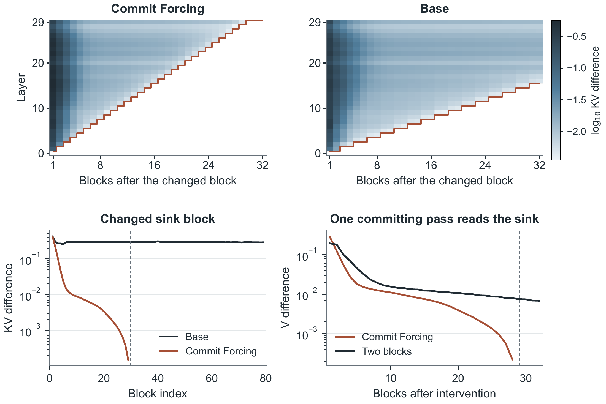

# Committing as a recurrence

Reading only the preceding block does not make each new KV entry independent of older blocks: the preceding entry
already contains context. This study derives the resulting layerwise dependence and tests it with fixed clean
latents on SGF. It is reported in the paper's **Committing as a recurrence** appendix.



## Fixed-block dependence

With the clean blocks, prompt and temporal-position assignments fixed, Commit Forcing forms a single-predecessor
chain:

$$
\mathrm{KV}_b=\mathcal F^{\mathrm c}_{\theta}(x_b;\mathrm{KV}_{b-1}),\qquad b\geq1.
$$

The first block has no historical input. The preceding block is read as stored KV; it is not re-encoded with the
current block. For an earlier entry $j<b$, the chain rule gives

$$
\frac{\partial\mathrm{KV}_b}{\partial\mathrm{KV}_j}
=J_bJ_{b-1}\cdots J_{j+1},\qquad
J_k=\frac{\partial\mathcal F^{\mathrm c}_{\theta}(x_k;\mathrm{KV}_{k-1})}
{\partial\mathrm{KV}_{k-1}}.
$$

KV in layer $\ell$ is projected from that layer's input, before its attention. With zero-based layer indices,
$\mathrm{KV}^{(\ell)}_b$ therefore depends only on blocks
$x_{\max(0,b-\ell)},\ldots,x_b$. Layer 0 depends only on the current block; each additional layer can carry
dependence back by at most one block. With KV from $h_0$ preceding blocks, the corresponding bound is
$\max(0,b-h_0\ell)$. Startup reads use only entries already available.

Self-only committing has no historical dependence under these fixed inputs. Base committing also reads the
persistent sink, creating a direct dependence on block 0 from layer 1 onward. The bounds specify which dependence
is possible; the trained weights determine its magnitude.

## Measurement

We use released SGF EMA weights, 30 layers, a 12-frame physical cache (3 sink, 6 recent and 3 current frames),
top-aligned positions and committing at $t=0$. The 20 diagnostic prompts are zero-based indices 0–20 except 5
from Self-Forcing's expanded MovieGen list, as in the separate
[fixed-trajectory recency diagnostic](../committing_content_age/README.md#fixed-trajectory-recency-diagnostic).
For generation seed 0, a 60-second, 80-block trajectory is generated with base denoising and Commit Forcing.
Its clean latents are then fixed. Cache reconstruction uses committing alone, without denoising or VAE decoding.

| Committing policy | Read context | Frames |
|---|---|---:|
| Commit Forcing | preceding block + current block | 6 |
| Two-block control | 2 preceding blocks + current block | 9 |
| Base | sink + 2 preceding blocks + current block | 12 |
| Self-only | current block | 3 |

Each readout compares the control and intervention tensors in the **new block's own slots**. For K and V separately,
we measure the relative L2 difference after converting both tensors to float32, with denominator
$\max(\lVert T^A\rVert_2,10^{-12})$. The norm covers all selected tokens, heads and channels. KV differences
average K and V across all 30 layers; the single-sink-read curve reports layer-mean **V** differences.
All values below retain the original dimensionless scale.

| Intervention | Changed input | Policies tested | Later entries measured |
|---|---|---|---|
| Content change | block $b^*=20$ or 40 uses the latent of $(b^*+40)\bmod80$ from the same video | Commit Forcing, base, self-only | lags 1–32 |
| Sink change | block 0 uses block 40's latent | Commit Forcing, base, self-only | blocks 1–79 |
| Single sink read | one committing pass at block 20 or 40 reads the sink; then the usual policy resumes | Commit Forcing, two-block control, self-only | lags 1–32 |

For content change and single sink read, paired caches are copied immediately before the intervention. The directly
modified entry is excluded. The single-sink-read pass replaces the preceding block with the sink under Commit
Forcing (3 sink + 3 current frames). Under the two-block control, it reads 3 sink + 3 recent + 3 current frames.
These two contrasts keep the read count fixed. The self-only intervention increases its context from 3 to 6 frames.
For the two-position interventions, positions are averaged within each prompt before prompts are averaged.
Reported intervals use 4,000 prompt-bootstrap draws, retaining both positions in each sampled prompt.

## Reported results

The content-change test has **3 × 1,280** entry comparisons and the sink-change test **3 × 1,580**: **8,580**
comparisons in total, each covering 30 layers. This count concerns those two interventions, not the separate
single-sink-read curves. No excluded layer differs from its control, and the first changed layer agrees with the
bound wherever a change is present.

| Intervention | Commit Forcing | Control / base |
|---|---|---|
| Content change | First changed layer at lag $d$ is layer $d$; exactly 0 from lag **30** onward | Base first changes at layer $\lceil d/2\rceil$; layer-mean KV difference is **0.0052** at lag 32 |
| Sink change | KV difference is **0.42**, **0.023**, **0.0088** at blocks 1, 5, 10; exactly 0 from block **30** | Base repeatedly reads the changed sink; mean KV difference over blocks 1–79 is **0.29** |
| Single sink read | Subsequent V differences are **0.28**, **0.13**, **0.055**, **0.028** at lags 1–4; exactly 0 from lag **29** | Two-block control retains V difference **0.007** at lag 32 |

Self-only committing gives exactly **0 for every subsequent entry in all three interventions**. The changed pass
itself is excluded from this statement. The 29-versus-30 cutoff is deliberate: changing a read leaves the
intervened block's layer-0 KV unchanged, whereas replacing its clean content can change layer 0.

In the figure, the top panels show log10 relative KV differences by lag and layer; white cells are exact zeros.
The bottom-left panel changes the sink block, and the bottom-right panel reads the sink in one committing pass.
The latter includes the recorded prompt-bootstrap intervals. The values in the table use the paper's prose
rounding; the [plot inputs](../../assets/source/committing_recurrence_inputs/) retain the reported aggregate
precision and interval endpoints.

## Scope and files

The proposition conditions on fixed clean latents, prompt and positions. It is **not a forgetting bound for free
generation**: older history can also affect newly generated clean latents through denoising. The empirical
verification uses one generator, one generation seed and the stated diagnostic prompts. It measures dependence,
not the visual usefulness of that dependence.

This 60-second own-entry/layer experiment is separate from the earlier
[48-second, newest-9 propagation study](../committing_propagation/README.md), which uses different readouts.
The nine-frame control here should not be substituted for the six-frame Commit Forcing rule.

- [Structured summary](summary.json): protocol, proposition, reported results and source hashes.
- [Standard-library reader](readout.py): validates the summary and existing aggregate plot inputs.
- [Aggregate plot inputs](../../assets/source/committing_recurrence_inputs/): two 32 × 30 layer maps, a sink-response curve and the single-sink-read means/intervals.

```bash
python analysis/committing_recurrence/readout.py
```

Source: the **2026-10-30 local manuscript working tree**, with `main.tex` directly including
`appendix/committing-recurrence.tex`. Source hashes use manuscript-relative paths in the summary. This export
does not add per-prompt data or latent/KV tensors and does not recompute statistics or intervals.
